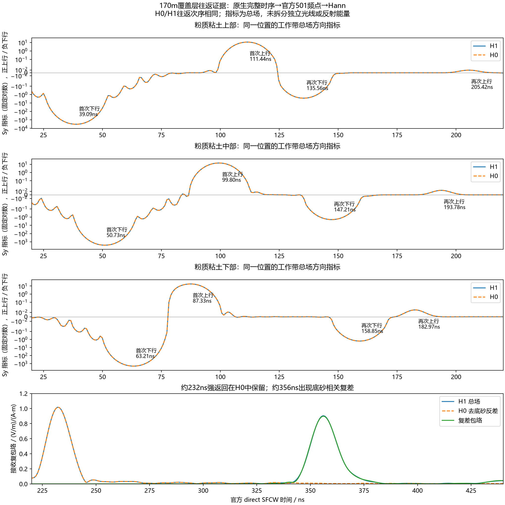

# 精细波场诊断：覆盖层多次返回、底砂响应与高频残留

2026-10-11。用户显性批准六项观察诊断及配套准备、分析、验收、可视化和归档。**六项全部一次完成并通过原生及本地交付验收**，累计求解2369.468s（39分29秒），无失败/重试。峰值owned RSS36.962GiB；94份原生/关键帧/数值文件和42份原始图件清单全部按大小与SHA256核验。32张PNG、10份入库GIF及可点击静态报告交付；原生大动画和90.563GiB快照留ROG。

**当前证据支持：B-scan上方强斜带主要与覆盖层的重复返回及侧偏传播有关；下方底砂相关带已经存在。不能继续将所有强带解释为侧边PML反弹，也不能把每道最大峰当成模型底砂顶。** 后处理的官方501点/复相位链路已核对；这不意味着真实天线、材料或数值收敛已经通过验证。

## 批次范围与官方依据

四项局部观察：剖面170、190m各H1/H0；内部x为站位−15→+5m，y=12→40m，空间保存2.5cm。0–550ns共833帧，120–440ns每9个原生时间步约0.530697ns，其余每17步约1.002428ns。每项31处完整2400ns时序，加Yee邻点共187接收器；五列偏移−12、−8、−4、0、+4m，各含空气、覆盖层上/中/下部、覆底泥岩、底砂参考面下方，再加实际Rx。

两项全域观察：170m H1/H0，内部x=0→210、y=0→42.4m，保存20cm、每17步，共2395帧/项，覆盖2400ns。输出步长不改变2.5cm求解网格。原生Ez/Hx/Hy float64；总计8122份三分量快照，字段有效载荷90.563GiB，原始全集留ROG。

沿用210×42.5m二维TMz、2.5cm求解网格、HORIPML80格、约8m离地、沿剖面1.3m收发、2400ns/40703样本、gprMax4.0.1原生FP64、官方单位impulse起始0、direct 20–170MHz/0.3MHz/501点、Hann/Blackman/补零8/无尾窗/无时移。覆盖层与砂岩Debye、论文泥岩εr18/σ0.006S/m保持。没有新材料、源、正式背景扣除、增益、空气等效或整线求解。

官方依据：[Snapshot API](https://docs.gprmax.com/en/latest/input_api.html#gprMax.user_objects.cmds_output.Snapshot)、[文本快照语法](https://docs.gprmax.com/en/latest/input_hash_cmds.html#snapshot)、[官方SFCW工具](https://docs.gprmax.com/en/latest/inc_SFCW.html)。文本快照命令无分量选择参数；专用入口给官方解析得到的Snapshot对象设置文档支持的`outputs=['Ez','Hx','Hy']`，再复用既有容量/编译缓存包装器。未修改官方场更新、快照插值核。站位、材料、采样频率和时限均为本项目批准参数，非官方强制要求。

首项170m H1完成并验收后才继续；失败停止、不重试，求解批次总上限10800s。契约SHA256：`6d7716e19759a2a0e044461762d9e3712b3ae930fef203a2fa598d636312ac0f`。ROG独立目录：`E:\djh\line9_fine_wavefield_20261011_r1`。

容量需区别保存分量与底层缓存：局部保存三分量16.683GiB，但现有官方CUDA回传会暂存六缓冲33.365GiB；全域相应11.916/23.833GiB。容量保护以实际RSS和系统余量为准，不能把三分量文件体积直接当主存需求。

## 为什么地质图与B-scan不会逐像素相同

地质图给空间中的材料分布；B-scan给每个站位的接收时间响应。同一覆盖层界面可以多次贡献回波，且抬高天线后，接收器可能收到测点侧方地表出射的场。显示中的每条带不一定对应一条独立地质界面。

既有41道短测线的底砂相关同站复差峰为190/180/170m的399.202/380.073/355.955ns，与真实H5底砂埋深变浅的趋势对应。174.5–173.5m全窗最大峰落到上方覆盖层返回，不能连成底砂轨迹。配对H0保留覆盖层，去掉连通底砂反差；它含真实地质响应，不是纯空气背景。H1−H0包含底砂及相关相互作用，不是整图clean。

## 覆盖层重复返回：完整工作带证据

下面到时来自完整40703点原生记录，使用官方direct的准确501频点与Hann，保留E/H相位及半时间步偏移。它不是对稀疏保存的快照作FFT。方向指标`Sy=Re(Ez·conj(Hx))`，正上行、负下行；是源归一化总场指标，未拆分单次反射能量。

170m中心列的H0与H1均出现相同次序：

| 覆盖层观察高度 | 首次下行/ns | 首次上行/ns | 再次下行/ns | 再次上行/ns |
|---|---:|---:|---:|---:|
| 上部，内部y28.875m | 39.088 | 111.444 | 135.562 | 205.422 |
| 中部，y27.775m | 50.732 | 99.800 | 147.206 | 193.779 |
| 下部，y26.675m | 63.207 | 87.325 | 158.849 | 182.967 |

下行依次经过上→中→下，上行经过下→中→上，然后重复；去掉底砂反差后次序保持。工作带H0的232.036ns强返回幅度1.017626，H1为1.017635，单位均为(V/m)/(A·m)；底砂相关复差则在355.955ns明显出现。



### 无拟合的局部平层估算

以数据库的完整复电性计算95MHz：覆盖层群折射率约3.3122、场衰减系数0.09314Np/m；从覆盖层内部看，地表和覆盖层/泥岩界面反射系数模约0.537和0.122。每多一次覆盖层往返，平层近似幅度乘数为`|r_surface r_cover/mud| exp(-2αd)`。

| 剖面站/m | 当地覆盖层厚/m | H0首次覆盖层返回/ns | H0后续强返回/ns | 后续/首次，实际 | 多一次往返，平层估算 |
|---|---:|---:|---:|---:|---:|
| 190 | 6.575 | 196.274 | 327.678 | 0.018945 | 0.019339 |
| 170 | 4.400 | 148.037 | 232.036 | 0.027677 | 0.028999 |

厚度减少2.175m，首次返回预计提前48.060ns，多一次往返的返回预计提前96.120ns；实际48.237/95.642ns。幅度数量级与斜率均与重复返回相符。这是有损法向局部平层近似，未计侧偏、角度、展宽和频带权重；不把近似吻合称为唯一射线路径闭合，也没有据结果反调材料。

泥岩95MHz场衰减约0.26626Np/m。190/170m的泥岩厚约7.10/7.35m，仅泥岩双程传播即损失32.84/34.00dB；平层估算底砂/首次覆盖层返回幅度比约0.03140/0.02748，实际配对底砂差场比约0.02793/0.02446。底砂虽可见，明显弱于首次覆盖层返回有传播依据；后续覆盖层返回恰好与底砂同数量级。该比值估算同样忽略角度、几何展宽与多径，不是绝对幅度标定或实测SNR。

### 侧偏传播与“同一片界面”的具体含义

170m主Rx处，232ns强返回的H1工作带净方向角约44.726°（从+x向+y），首次覆盖层返回约68.087°，底砂窗总场约68.061°。后续强返回更偏斜；H0该强返回角44.726°基本保持。

190m当前材料/官方冲激的327.678ns强返回净方向约45.103°。182m空气点上行极值288.589ns，加到Rx真空传播39.643ns得到328.232ns；当地净方向43.833°、直连Rx43.295°。与170m左偏8m的候选关系相似，但仍未认证唯一反射点和误差界。

既有Blackman复轮廓也保留170/190m的232.036/327.678ns覆盖层强峰和355.955/399.202ns底砂差场峰；覆盖层强峰净方向约44.905/44.802°，与Hann约44.726/45.103°相近。窗口改变幅度和旁瓣，但这两类事件不是Hann单独制造的。本轮未据此更换正式窗。

空气观察列中，剖面162m处约192.947ns上行极值，加到Rx的真空几何传播39.586ns，得到232.533ns，与Rx232.036ns接近；其观察净方向48.325°，直连Rx方向43.207°。这支持“左侧约8m出射区域”的候选，而非强迫从天线正下方反射。仍不能把局部净方向当唯一光线：有重叠、干涉、观察点间距和门窗边缘；所有候选及失败/边缘候选保留在事件表中。

“不同站位响应同一片界面”是指天线收到的场可以来自一片侧向范围，不是只取测点正下方；相邻测点的响应范围会重叠。当前覆盖层重复路径也会在时间图中产生第二条带，不需增加新的地质层才能出现它。

## 侧边PML是否主导当前强带

170m源/收内部x149.35/150.65m，右PML内沿x208m。到右侧再返回的真空几何最短距离约116m，对应386.934ns；左侧更远。该几何时间是物理参考，不是数值前驱或全域PML收敛证书。

仅在内存中诊断截取同一H0原生记录，仍用准确501点/direct/Hann：只保留360ns前，220–245ns窗相对完整记录复L2变化0.0006366（0.06366%），峰仍232.036ns；只保留380ns前变化0.09740%。正式记录、源、窗口均未改。有限频带反演有非因果旁瓣，因此只比较贡献，不用“早于最短时间”单独证明全部边界无影响。260ns硬截断会产生明显频谱泄漏（37.29%复变化），仍保留同位置强峰；不采用该诊断截断作为正式处理。

这些结果与覆盖层探针相互支持，明显削弱“右侧回波主要造成232ns强带”的解释。顶部PML距离较近、底部/侧边晚期交互及其他站位仍不能从这一检查一并排除。旧材料/Ricker的顶+20m、右+40m对照只作历史背景，不冒充本批材料的独立收敛试验。

全域动画标出80格PML内沿，供观察晚期场向边界传播和返回；仅凭颜色亮纹不能定量分离PML反射系数，尤其原始冲激场中有高频数值纹理。

## 末尾残留与快照为什么会有密集纹理

三个已有配对站1800–2400ns原生记录的诊断谱峰均约8.465247GHz，接近时间奈奎斯特频率8.479411GHz。170m H1/H0的该诊断谱20–170MHz能量比例约2.52e−20/1.26e−20，>1GHz占比>99.99999999%。这些数来自仅用于诊断的Hann尾段FFT，不等于正式SFCW的尾窗或严格带内能量认证。

官方单位impulse激发宽频场；8GHz级波长当前空间网格不能物理解辨，近奈奎斯特残留更像高频数值响应，具体机制未唯一定位。不能据此指称4.0.1更新核错误，也不能把它自动叫真实雷达回波。

局部快照0.531ns左右的保存间隔不足以无混叠分辨8.465GHz，稀疏快照还有空间平均。动画的密集红蓝纹理不可直接解释成工作带散射或反射路径，也不能对快照补个FFT便声称获得准确工作带场。方向结论用保存每个原生时间步的探针；原生E在n·dt、H在(n−0.5)·dt，方向计算必须按时间/空间同位处理，末样本无法对齐则舍去。

此前五站的已记录末120ns贡献诊断，250–550ns复轮廓变化均小于7e−7；本批170m H0的末120ns对220–245ns强返回窗贡献约2.15e−7。因而“尾峰超过−60dB”不能单独解释当前工作带强条纹。2400ns以后的未记录响应、完整频谱及其他事件仍未通过时窗收敛认证。

## 如何看图与动画

公开目录：`artifacts/research_checks/2026-10-11_line9_fine_wavefield_r2/`。三幅波场始终按H1总场、H0去底砂反差、H1−H0场差排列；各站/视野的整段动画用共同绝对场尺度、固定对数显示，不逐帧归一化。绿线地表、橙线覆底、黑线底砂参考；H0中黑线仅为参考位置。

局部静图保持800×1120原生场像素/面板；全域为1050×212输出像素/面板。原生局部动画在关键段保留每个保存帧；文件过大者留ROG。`*_preview.gif`另有显性图像缩小/帧抽取标签，仅用于预览，不改变原生记录或正式处理。

另交付`x170/x190_local_detail_240ns/360ns.png`，按两站各自取回的8个晚期关键时刻固定共同色标，排除源瞬间的大动态范围以看清细节；三幅仍使用相同绝对单位。色标来源与哈希在`key_detail_render_receipts.json`。不能跨这两种显示尺度凭亮度比幅度；H5数值不变。所有数组800×1120，以无插值显示。

重点看：170m与190m的`*_local_return_preview.gif`、`*_local_basal_preview.gif`，以及`x170_global_global_late_preview.gif`。局部场差可见底砂相关扰动先在深部、再进入覆盖层/空气；这说明响应有传播过程，不代表场差中的所有细密纹理都是物理20–170MHz波。

`x170_cover_roundtrip.png`是主证据；`x170/x190_main_and_tail.png`给官方工作带接收对照与尾段谱；`*_band_direction.png`给同次激发五列/六层观察图，明确不是移动天线B-scan。`*_probe_events.json`保留门窗和边缘极值，不强造事件对应。

最终可点击报告：`wavefield_report.html`，动画仅在点击后加载。公开含8份预览和两份不足40MiB的原生全域动画；6份206–351MB的原生局部动画留ROG`E:\djh\line9_fine_wavefield_20261011_r1\delivery_r1`。预览图像约缩小3倍（全域2倍）、沿用原预览抽帧；具体帧数、时间步与压缩来源见`snapshot_render_receipts.json`及`preview_reduction_receipts.json`。

R1分析草稿有一处诊断门窗错误：190m的220–350ns最大值会误选222ns首次反射旁瓣，非327.678ns后续返回；最终R2改为既有父批已识别事件的300–350ns门窗（170m为220–270ns）。首次返回显示行也改为只根据显示窗设纵轴，避免窗外直耦大峰压扁曲线。没有新求解、源/正式SFCW/数值数组/动画变更。原R1图件与分析脚本保留本机忽略目录；最终`analysis.json.plot_revision`单列修订身份。

## 验收与可复现边界

准备器、专用输出入口：[line9_fine_wavefield.py](../../scripts/line9_fine_wavefield.py)、[gprmax_fine_snapshot_entry.py](../../scripts/gprmax_fine_snapshot_entry.py)。独立输入审计：[audit_line9_fine_inputs.py](../../scripts/audit_line9_fine_inputs.py)。分析：[analyze_line9_fine_wavefield.py](../../scripts/analyze_line9_fine_wavefield.py)、[机制检查](../../scripts/line9_fine_mechanism_checks.py)。取回/独审：[导出器](../../scripts/export_line9_fine_delivery.py)、[audit_line9_fine_delivery.py](../../scripts/audit_line9_fine_delivery.py)。

每项验收全部快照的哈希、dtype、形状、版本、时刻和有限值；局部31处探针独立重建快照单元中心，最大差为0。主Rx与源记录同基线逐字节相同，新增被动观察未改变求解结果。工作带E/H分别按原生半步偏移计算官方响应，以分散频点独立DTFT与独立逆和交叉检查；不把工作带净指标称为独立射线能量。既有11项同位/方向/驻波反例检查通过。

六项执行时间：170H1局部390.203s、170H0局部390.765s、190H1局部386.047s、190H0局部387.922s、170H1全域407.468s、170H0全域407.063s。全部8122快照在ROG逐文件验收；本机独立复查取回的46帧及全部原生探针。独立探针DTFT最大相对L2约2.920e−12、逆和1.196e−12；本机另选频点核对主Rx最大4.429e−12。10项Windows监督器CPU检查和11项同位控制通过，分别是进程/数组检查，不是额外物理收敛。

完整取回：`artifacts/local_checks/2026-10-11_line9_fine_retrieval_r1/data`，数值为其`analysis_arrays`。原生取回包SHA256 `e0fb66f38c9a5a86a2a05228fc4aba3b0c727b1f46de3471e38052c696d91ce1`；原图件取回包`584e18d5db8a51933aa621b42fbd3cdf6262df22f219bc04881979a1c1cba119`。公开`public_retrieval_manifest.json`记录原R1取回身份；最终R2文件身份另存`final_public_manifest.json`，不以修订图覆盖旧哈希。

本机复核/细图/修订复现，均不调用求解器：

```powershell
& artifacts/local_checks/gprmax_v401_gpu_env/Scripts/python.exe scripts/render_line9_fine_keys.py --root artifacts/local_checks/2026-10-11_line9_fine_retrieval_r1/data --package artifacts/local_checks/2026-10-11_line9_fine_wavefield_package_r2 --out artifacts/research_checks/2026-10-11_line9_fine_wavefield_r2
& artifacts/local_checks/gprmax_v401_gpu_env/Scripts/python.exe scripts/analyze_line9_fine_wavefield.py --source artifacts/local_checks/2026-10-11_line9_fine_retrieval_r1/data --out artifacts/research_checks/2026-10-11_line9_fine_wavefield_r2 --private artifacts/local_checks/2026-10-11_line9_fine_retrieval_r1/data/analysis_arrays --refresh-plots
```

本轮能解释当前合成模型中两条带的来源，并排除若干主导因素；不能证明真实天线/横向收发与二维线源等效，不能认证粉质粘土/砂岩配方为现场实测值，不能认证3D、网格、PML、记录长度全面收敛。

下一步应先根据当前已区分的覆盖层返回与底砂响应，具体敲定真实天线及横向收发的最小对照；如需更高证据强度，再对敏感站设计当前材料的边界/时窗收敛。不能为了让图像像地质剖面，直接扣掉平缓层或改材料。未批准新增求解，391道、空气等效与正式处理变化均未启动。
