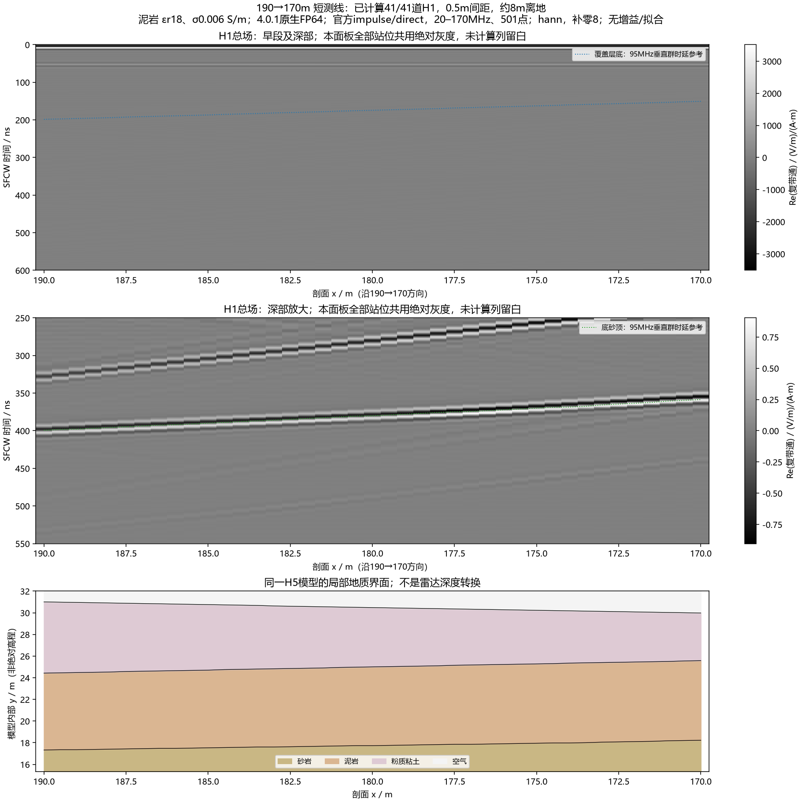
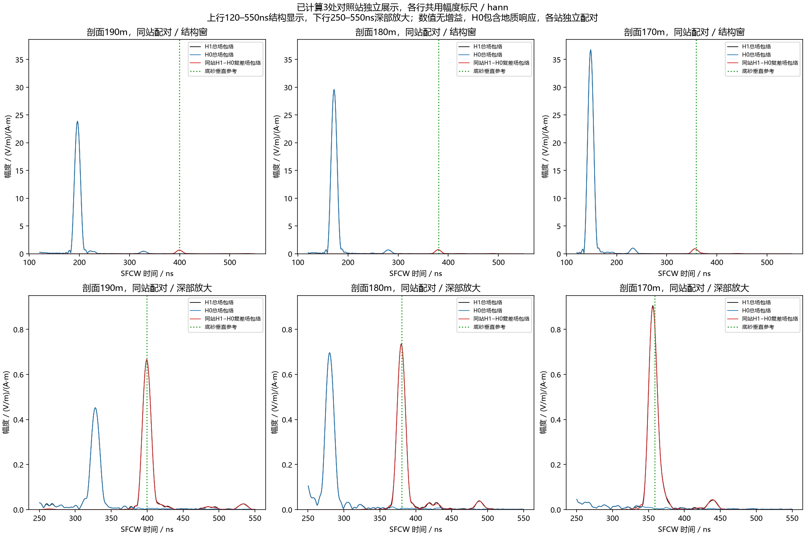

# 190→170m短测线：42项完成、41道B-scan已验收

2026-10-11，用户明确选择“批准上述批次，跑完验收并推送”。ROG新增42项全部一次完成，复用190m两项，得到41道H1总场和三处同站H0/H1。**底砂对应的连续回波已随模型埋深变化而提前；覆盖层相关强返回仍然存在，不能把每道最大峰都当底砂。** 11/41道H1的2400ns尾部未达到官方−60dB建议，本轮不签认全线时窗收敛或实测一致性。

## 冻结范围

- 剖面x=190→170m、最终0.5m间距，共41道H1总场；相对220m起点的累计距离为30→50m。
- 190m现有H0/H1输出复用；仅新增40项H1和180、170m两项H0，共42次求解。
- 先180、170m两对H1/H0，再补1m整数骨架，最后补半米站位。三个同站差分独立展示，不插值制造整线H0或差场。
- 沿用论文泥岩εr=18、σ=0.006S/m、无Debye；覆盖层/砂岩现行Debye配方和空气保持。[当前数据库](../../configs/research/line9_materials_v0_2.json)，材料为研究配方，非场地实测标定。
- 域210×42.5m，二维TMz，2.5cm均匀网格，HORIPML80格，界面平均，收发沿剖面间距1.3m，各自距当地地表约8m，记录2400ns/40703样本。
- gprMax4.0.1、CUDA原生FP64、官方单位impulse、起始0；direct SFCW 20–170MHz/0.3MHz/501点；既有Hann/Blackman、补零8、无尾窗、无时移；不新增增益、拟合、homodyne、观察器或快照。
- 新批总时限21600s（6小时），单项及容量/owned进程停止/600s心跳/不重试保护保持。停止或失败只交付已核验的完成站位，不假称完整测线，也不自动重跑消耗的attempt。

官方依据：[4.0.1 SFCW手册](https://docs.gprmax.com/en/latest/inc_SFCW.html)的Preparing the model、direct、TimeSampleOffset、合并B-scan及Frequency and time-window validity。站位、材料、道间距和时窗是本项目选定且用户批准的参数，不称官方要求。

## 准备和执行身份

准备器：[line9_overnight_bscan.py](../../scripts/line9_overnight_bscan.py)，调用既有原生冻结/求解/审计器。全部42份输入独立核查通过：域、网格、时窗、PML、界面平均、源命令与两项已完成输入相同；H0/H1模型及材料文件分别与父包逐字节相同。仅站位、标题和几何文件相对引用变化。

41个站位均处于地表之上，距离顶部PML最小1.475m。模型底砂顶埋深从190m的13.675m减至170m的11.75m；该段适合检查到时趋势。95MHz局部垂直群时延参考在求解前从实际H5剖面计算，是参考曲线，不是地形射线真值或实测深度转换。

父准备包：`artifacts/local_checks/2026-10-11_line9_paper_mudstone_window_package_r2/`。

新本机准备包：`artifacts/local_checks/2026-10-11_line9_overnight_package_r1/`。

ROG独立目录：`E:\djh\line9_overnight_20261011_r1`，现有4.0.1运行时由现有base Python加原依赖路径调用，无安装或环境文件修改。

新执行契约SHA256：`ed9791f14cbf60b11c046671e96eda661a719f98dfb58d88c511dc2d5e4bc0bd`。

2026-10-11北京时间01:13左右正式启动。首项180m H1完成358.797s，原生float64及哈希/源半步/位置/形状/版本通过；其末5%尾峰约−61.48dB。复用190m官方处理与此前数值重现一致；缺失站位保留NaN，未插值。180m总场深部主峰约380.073ns，190m约399.202ns，仅为当前两站观察，尚不作为整线结论。

42项累计求解15183.625s，约4小时13分钟，平均361.515s/项；owned峰值RSS约3.156GiB。启动北京时间01:13:25，完成证书写出北京时间**05:26:34**；零FAILED/GUARD_STOP事件。ROG再次完整verify通过，现已无owned Python求解进程，GPU约1%、767MiB。用户随后询问状态时完成全部取回与本机验收；不将计算完成时间冒充图件验收时间。

完整取回`artifacts/local_checks/2026-10-11_line9_overnight_results_r1/`，215文件大小及SHA256逐项通过。归档SHA256 `0e0af69ac4a0e1c90db7986925bf6be5068f65b0fa5bb6936d36b19306df6361`，与ROG导出一致；完成证书SHA256 `d55714527a8dac0c30ffaf940488c0bf9eb771900b206106a105eb62dbed8e19`。

## 已完成的验收与交付

分析器：[analyze_line9_overnight_bscan.py](../../scripts/analyze_line9_overnight_bscan.py)。取回逐文件SHA256/大小，核验完成收据及原生dtype、源、位置、dt和40703样本。三个配对站对全部501点做独立DTFT核对，其他站作18点分布式核对；官方完整501点计算全部保留。逆重建以独立指数求和核对，并用170m H1实际官方CLI交叉检查。

全部44份原生记录（42新＋2复用）为float64，位置/版本/源样本及半时间步通过。最大独立DTFT相对L2约5.215e−12，Hann/Blackman逆求和相对L2约1.278e−14/1.371e−14；实际官方CLI与170m H1复轮廓相对L2约5.125e−16。独立[交付审计器](../../scripts/audit_line9_overnight_delivery.py)复算输入不变量、取回输入字节、完成收据、41×501复谱和三站差分形状，以及数值表格。证书：[delivery_verification.json](../../artifacts/research_checks/2026-10-11_line9_overnight_bscan_r2/delivery_verification.json)。这些是运行和数值一致性证据，不是场地物性认证。

| 剖面x / m | 底砂顶埋深 / m | 95MHz垂直参考 / ns | H1及同站差场深部峰 / ns |
|---|---:|---:|---:|
| 190 | 13.675 | 399.429 | 399.202 |
| 180 | 12.750 | 380.241 | 380.073 |
| 170 | 11.750 | 358.525 | 355.955 |

三处同站H1−H0峰从399.202提前到355.955ns，变化43.247ns；先验垂直参考变化40.904ns。Hann/Blackman到时一致。完整B-scan中的下方连续带贴近底砂参考，支持本段底砂响应已可见且随几何变化。参考未考虑完整侧偏射线、有限天线和群频率差异，170m相差约2.57ns不应被拟合或强制对齐。

上方另一条强带仍存在，与之前的覆盖层相关返回证据相符，不因泥岩损耗调整而消失。**174.5、174、173.5m的250–550ns全窗最大峰分别约254.49、252.00、250.33ns，落在这条强带而非约369–368ns底砂带；到173m最大峰又跳回约363.44ns。** 这是不同响应抢占最大值，不能据最大峰连线判断底砂突然跳变。H0最大值在170m的深部窗很小，也不能宣称背景总体消失：更早的强返回已移出该统计窗，结构显示行保留它。未据此增加峰追踪、背景扣除或其他正式处理。

全部44记录末5%尾峰范围约−65.14到−57.25dB，其中12份超过−60dB建议（11道H1及170m H0）。190/180m达标不能外推到整段；2400ns仍有站位需要后续长度敏感性核查。保持已批准记录和无尾窗处理，不擅自加长、加窗或补跑。末尾宽频残留是否影响各站正式深部频带尚未逐站完成长度收敛验证。

交付Hann/Blackman中文灰度B-scan（全窗与深部共同尺度）、真实H5局部地质剖面、局部垂直到时参考和三个同站配对对照。原生H5/数值复谱保留本机忽略目录；图、契约、日志和限制入库推送。

正式公开目录：`artifacts/research_checks/2026-10-11_line9_overnight_bscan_r2/`。R2只是增加对照图深部放大行的最终展示版本；原R1分析/代码副本保留在`artifacts/local_checks/2026-10-11_line9_overnight_delivery_draft_r1/`及`2026-10-11_line9_overnight_draft_analyzer_r1.py`。**仿真只有这一个42项R1批次，没有因绘图调整新增求解。** 数值结果为`artifacts/local_checks/2026-10-11_line9_overnight_sfcw_r2.h5`。





Blackman对应图为同目录`bscan_blackman_gray.png`、`anchor_pairs_blackman.png`。全窗受直耦/浅层动态范围支配；深部用全站共用的另一绝对显示标尺，无AGC或逐道归一化。三站对照上行120–550ns仅为结构显示，下行250–550ns为既有深部放大窗，统计及SFCW参数均保持。

本机分析复现（输出路径必须不存在，父包及原生结果保持只读）：

```powershell
& artifacts/local_checks/gprmax_v401_gpu_env/Scripts/python.exe scripts/analyze_line9_overnight_bscan.py --raw artifacts/local_checks/2026-10-11_line9_overnight_results_r1 --out artifacts/research_checks/overnight_review_new --numerical artifacts/local_checks/overnight_review_new.h5 --cli artifacts/local_checks/2026-10-11_line9_overnight_official_170_H1_r1.h5
```

本次短测线交付已完成，不是空间/网格/三维收敛认证或实测一致性验收。H0包含真实地质响应，H1−H0含底砂及相关传播交互，不是整图clean。空气等效继续搁置，不扩展391道或其他物理配置。后续先看这段已可见的底砂带及上方强返回，再具体设计尾部敏感站的记录长度检查；任何新求解、整线或实际天线配置仍须单独显性许可。
