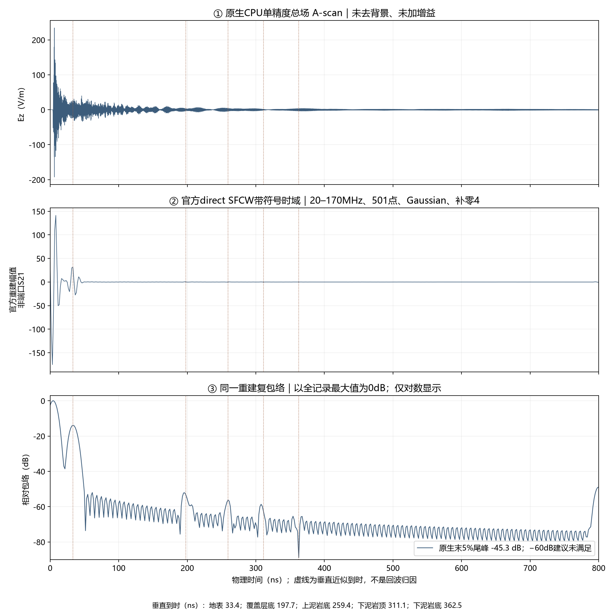
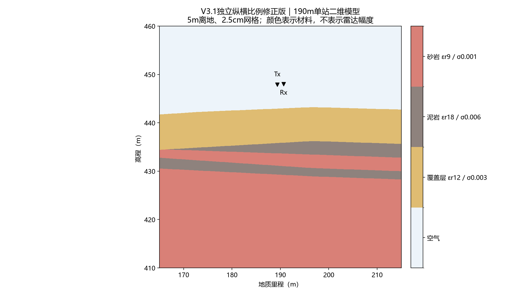

# V3.1高程比例修正版：ROG原包CPU单精度单道试跑

日期：2026-10-12。用户在具体运行方案中选择 **“严格原包CPU单精度试跑”**。已完成一项190m站位正演、原包官方SFCW处理、结果取回、独立复算与中文图件。没有加GPU/双精度参数，没有修改包内三个Python脚本、JSON或参考矢量。现行模型指针、`model_current/`、环境及其他批次均未修改。本次是独立候选试验，不是正式测线，也不是仅改变高程比例的受控消融。

## 执行结果与交付

| 项目 | 实际结果 |
|---|---|
| 求解器/后端/原生精度 | gprMax 4.0.1，CPU/OpenMP，接收记录原生float32 |
| 正演数量 | 1项；未新增H0、B-scan、快照或收敛对照 |
| 原生记录 | 14283点，dt=5.6018040497805×10⁻¹¹ s，要求时窗800ns |
| 求解耗时 | 官方日志170.7801s；含进程启动与监视收尾172.296s，约2分52秒 |
| 采样内存峰值 | 602,505,216字节，约575MiB；2秒监视采样，不保证捕获瞬时峰值 |
| 原包文件身份 | 九个原始文件逐项SHA-256与ZIP一致；原生/处理/几何等15项清单文件本地校验通过，五阶段日志哈希通过 |
| 官方SFCW | direct，20–170MHz，步长0.3MHz，501点，Gaussian默认σ=0.2，补零4，2004个重建时间样本；无尾窗、无时间移位 |
| 独立频谱复算 | 保留官方源/接收时间偏移，定义求和相对L2差4.9183×10⁻¹³ |
| 独立逆变换复算 | 同一频点、权重和幅度定义，直接逆求和相对L2差7.9332×10⁻¹⁴ |
| 原生末5%尾峰 | −45.27624dB，**未满足官方−60dB建议初筛**；不认证记录长度收敛 |





[单道灰度图](../../artifacts/research_checks/2026-10-12_line9_v31_original_cpu_r1/single_station_gray.png)只显示同一站位；没有把未计算的相邻站位插成B-scan。未加增益、去背景、逐道归一化或换窗。图中dB仅为同一复包络相对全记录最大值的对数显示，不改变保存的数值，不叫SNR。

公开图与证据目录：`artifacts/research_checks/2026-10-12_line9_v31_original_cpu_r1/`，含`audit.json`、冻结`contract.json`、远端`completion.json`和五阶段`receipts.json`。原始ZIP、PDF矢量、模型H5、完整日志和原生结果留本机忽略目录及用户授权的ROG，不把原始地质资料上传Git。

## 原包与实际模型

用户提供的路径被写成了多级目录；实际文件为本机：

`E:\wslubuntu2204\line9_GPRMax401_%E6%A0%B8%E5%BF%83Python_JSON_V3.1_%E9%AB%98%E7%A8%8B%E6%AF%94%E4%BE%8B%E4%BF%AE%E6%AD%A3%E7%89%88.zip`

ZIP大小29,671字节，SHA-256：`ede5d676bb97964eb19c1a4c4b4b8b99d4f41ebc45bd36e9756da6b893d5c056`。引用的ChatGPT对话只提供了用户侧预览，当前没有`read_thread`工具，未声称读到完整对话；执行身份依据实际包内文件。

原包先生成350×50m、2800万体素母模型，再裁取里程165–215m、高程410–460m的50×50m求解域。TMz、2.5cm网格、400万单元、稳定系数0.95、HORIPML的四个有效面各80格。Tx/Rx相距1.3m，分别按各自脚下体素地表抬高5m；两者并非同一绝对高程：

- Tx：局部(24.35,37.925,0)m，地质里程189.35m、高程447.925m。
- Rx：局部(25.65,38.000,0)m，地质里程190.65m、高程448.000m。

源为官方单位impulse、z极化HertzianDipole；这是二维理想线源，没有实体领结或真实天线结构。材料是非色散常数：覆盖层εr12/σ0.003S/m、泥岩18/0.006、砂岩9/0.001；空气自由空间。这些是论文假设配方，不是现场标定，也与现行覆盖层/砂岩Debye配方不同。

独立纵横比例已在原脚本中应用：水平约8.024571249 PDF点/m，纵向8.016003 PDF点/m。原脚本回读母模型材料分类错配0，单道裁剪与母模型一致，ZK08四接触深度相对图纸标注差约0.0060/0.0040/0.0048/0.0114m。它们是图纸内部一致性检查，不代表现场达到厘米级精度。未取得原CAD独立标定。

## 波形可以说明什么

总场及官方重建中，早期直达波与地表响应占主导。对数包络上约200、260、310ns附近存在较弱起伏，与几何和介电常数给出的垂直近似到时接近；本次没有删掉这些分量。接近不构成唯一归因。

近似参考只用于读图。设c为真空光速、h=5m、每层厚度为dᵢ、该层相对介电常数为εᵢ。忽略损耗对相速度的修正、斜坡、收发偏移和侧向传播时，非磁性均匀层速度vᵢ≈c/√εᵢ；代入双程传播时间2dᵢ/vᵢ，得到2dᵢ√εᵢ/c。从空气往返2h/c开始，逐层累加。因此参考时间不是从雷达波形拟合的标签。

| 几何参考 | 190m处高程（m） | 垂直近似双程（ns） | 该参考时刻复包络相对全局峰（dB） |
|---|---:|---:|---:|
| 地表 | 442.9619 | 33.356 | −13.88 |
| 覆盖层底 | 435.8502 | 197.707 | −53.14 |
| 上泥岩底 | 433.6718 | 259.363 | −56.34 |
| 下泥岩顶 | 431.0890 | 311.055 | −62.51 |
| 下泥岩底 | 429.2724 | 362.473 | −86.13 |

最后一列是固定参考时刻插值读数，**不是附近峰值、界面反射强度或检出统计**。最深界面不能据这一项宣称检出或不存在。没有匹配H0，无法排除旁瓣、其他路径与背景在这些时刻的贡献。

800ns附近包络上扬与原生尾部未充分衰减同时存在；没有裁窗对照，不能定量认定该上扬全部来自截断。全冲激尾部也不能直接当作20–170MHz带内误差。本批没有偷偷加尾窗、延长记录或裁掉晚波；原始输出完整保留。Gaussian窗和低频带限本身也会改变时间轮廓，不能把显示上的周期纹理自动叫作地质层。

这次确认的是：原包可以在现有4.0.1环境真正运行，原始输出是单精度，官方direct SFCW链与独立定义求和一致。尚未确认：800ns记录收敛、50m域/PML影响、单精度动态范围、界面分量唯一归因、真实天线/3D响应和实测一致性。比现行结果存在几何、材料、时窗及窗函数等多项变化，不能把结果差异仅归因于纵向比例修正。

## 执行、复现与停止边界

ROG独立根目录：`E:\djh\line9_v31_original_cpu_20261012_r1`。本地完整取回目录：`D:\自动处理\artifacts\local_checks\2026-10-12_line9_v31_candidate_r1\retrieved`。其中原始正演和SFCW为：

- `package\results\line9_pilot_impulse.h5`
- `package\results\line9_pilot_sfcw.h5`

先前隐藏进程启动没有产生`attempt.json`、求解进程或输出；SSH退出后该进程已消失。之后使用保持打开的SSH执行原包，正式求解仅一次完成。没有把基础设施启动动作计作已运行正演，也没有重复已开始的求解。

外部监督器[scripts/run_line9_v31_original_cpu.py](../../scripts/run_line9_v31_original_cpu.py)只负责原包解压、哈希、五阶段原始命令、最多一项求解、600秒会话租约、用户停止文件、内存与一小时时限、失败停止和收据。它没有改动`gprMax.run()`调用或任何源/材料/处理参数。实际顺序：`01_build_geometry.py`、`02_run_ascan.py`、`02_run_ascan.py --solve`、原包SFCW `--inspect`、原包SFCW `--process`，五阶段退出码均0。

图件和独立复算入口：

```powershell
& 'artifacts/local_checks/gprmax_v401_gpu_env/Scripts/python.exe' scripts/analyze_line9_v31_original_cpu.py --root artifacts/local_checks/2026-10-12_line9_v31_candidate_r1/retrieved --out artifacts/local_checks/line9_v31_new_analysis
```

输出目录须不存在，避免覆盖旧证据。入库分析脚本已在新的本地目录独立重跑；审计JSON语义相同，三张PNG字节相同。无关算子回归不用于替代这次原生输出审计。

依据：[官方CPU默认单精度与加速器说明](https://docs.gprmax.com/en/latest/accelerators.html)、[官方Scene/run接口](https://docs.gprmax.com/en/latest/input_api.html)、本机与ROG的4.0.1实际API默认值、官方SFCW CLI及`processing.py`中`direct_frequency_response`、`reconstruct_time_response`、`tail_relative_db`。Gaussian和补零4是原包选择，不是官方强制参数。

预期是一项原包CPU单精度试跑，实际与此一致。唯一明确未通过的初筛是800ns尾部−60dB建议；没有把它隐去或扩大成唯一病因。下一步建议先敲定同配置的记录长度对照，再决定是否需要边界或匹配背景；这些都是新求解，**本批没有执行或默认获得许可**。
