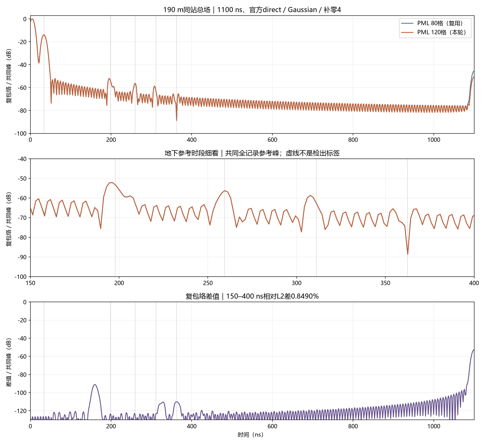
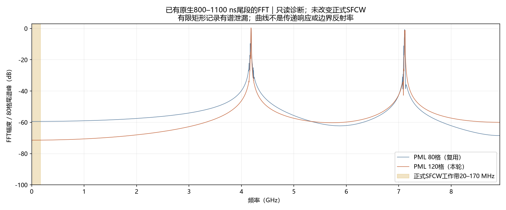

# V3.1：固定1100 ns的PML80/120格单道对照

2026-10-12启动求解，2026-10-13验收归档。用户在具体方案“固定1100 ns，单独比较80格与120格PML”后明确指示“做下一步”。本批新增一次ROG CPU单精度求解，复用1100 ns/PML80结果，已完成并取回。没有自动追加时窗、PML厚度、精度或B-scan批次；现行模型指针不变。

预期：检查边界配置是否影响原生尾部和工作带响应。实际：PML加厚使末尾峰值降低8.447 dB；正式工作带及地下参考窗变化小。原生尾部仍未满足官方−60 dB建议。已有尾段的主频约4.183 GHz，不能把这一宽带高频残留直接当作20–170 MHz地下回波误差。

## 配置与执行验收

两项均为gprMax4.0.1、CPU/OpenMP single、50×50 m、2.5 cm、2000×2000×1格、190 m站位、5 m AGL、1.3 m收发间距、1100 ns、19638个原生float32样本。源仍为内置impulse和二维HertzianDipole。材料保持原包常数：覆盖层εr12/σ0.003、泥岩18/0.006、砂岩9/0.001，σ单位S/m。没有改为当前生产模型的Debye材料或有限天线。

唯一改变的配置是`pml.cells_by_face`：`[80,80,0,80,80,0]`→`[120,120,0,120,120,0]`，仍为HORIPML及既有默认系数配置。四个有PML的面的厚度由2 m增至3 m，总域不变，内边界每面向域内移动1 m。因此这是PML厚度/对应默认系数及入口位置共同随单一配置项变化的敏感性对照，不是保持PML入口不变的反射率测量，也不能区分空气顶边与左右地层边的各自贡献。

母模型、裁剪H5字节及材料数组/属性相同；接触面和材料JSON相同。把新配置中的PML厚度恢复为80格后，整份JSON与1100 ns基线相同。原包其他八文件未改，原ZIP未改。完整源历史逐比特相同，时间步长同为5.6018040497805006×10⁻¹¹ s，源/接收位置及Yee时间偏移相同。120格时最近接收器到PML内边界约9 m，即360格，原包静态净空检查通过。

ROG120格求解阶段含监督261.297 s（约4分21秒），80格为237.328 s。一次求解成功，五个执行阶段退出码均0。各15项包内文件及五项日志SHA-256/大小核验通过；远端completion与取回字节一致。独立DFT与官方复频谱相对L2差5.29×10⁻¹³；独立逆求和与官方复包络差7.93×10⁻¹⁴。分析复跑的审计JSON、五PNG字节和NPZ数组一致。

SFCW仍使用官方direct、20–170 MHz、0.3 MHz、501点、Gaussian默认σ0.2、补零4。没有尾窗、时间平移、增益、背景扣除或逐道归一化。接收电场/源之比不是端口S21。

## 尾部、频谱及参考时段

| 核查项目 | PML80格 | PML120格 |
|---|---:|---:|
| 原生末5%区间峰/全记录峰 | −46.348 dB | −54.796 dB |
| 官方−60 dB初筛建议 | 未满足 | 未满足 |
| 原生样本数/精度 | 19638/float32 | 19638/float32 |

以下相对L2差定义为`||120格结果−80格结果|| / ||120格结果||`，不是相对干净物理真值的误差。

| 范围 | 相对L2差 |
|---|---:|
| 全原生接收波形 | 2.4382% |
| 全部501点复数频谱 | 0.2229% |
| 20–40 MHz复数频谱 | 0.4604% |
| 40–95 MHz复数频谱 | 0.2562% |
| 95–170 MHz复数频谱 | 0.1896% |
| 0–100 ns重建复包络 | 0.0001422% |
| 150–400 ns重建复包络 | 0.8490% |
| 400–800 ns重建复包络 | 0.3380% |
| 800–1100 ns重建复包络，含截止端点 | 74.4031% |

逐频幅度差最大0.04322 dB，相位差最大0.27620°。相位差为包裹相位，弱谱点应结合幅度解释。原生接收波形首次可观察逐比特差异约57.923 ns，这只记录数值差异出现的位置，不是物理反射到时判据。



不能只用整个地下区间的平均差。另按既有几何垂直近似到时建立四个固定±15 ns窗；没有从本轮输出选择窗或移动中心。

| 参考对象 | 中心近似到时 | 窗内复包络相对L2差 |
|---|---:|---:|
| 覆盖层底 | 197.707 ns | 0.03038% |
| 上泥岩底 | 259.363 ns | 0.05597% |
| 下泥岩顶 | 311.055 ns | 0.25160% |
| 下泥岩底 | 362.473 ns | 0.56932% |

到时按5 m空气路径、层厚和c/√εr估计，忽略双站偏移、坡度及损耗速度修正。窗内总场含旁瓣与其他路径，不等于已分离界面回波。最深参考时刻接近波谷，单点复数相对变化6.37%，不能把窗内小变化外推为每个弱样本都稳定，更不能认证最深界面已检出。

## 晚期残留的频率线索

对两份已有原生记录的800–1100 ns区间，读取原值并作矩形有限记录FFT。这是诊断，未修改、滤波或重新生成正式SFCW输出。两项尾段谱峰均为4.182878 GHz，FFT频率间隔约3.333 MHz。20–170 MHz的有限记录谱能量比例约为8.82×10⁻⁶和5.72×10⁻⁷，即0.000882%和0.0000572%。比例按rFFT的DC/Nyquist与成对频率权重计算；它有谱泄漏和频率分辨率限制，不是经过源归一化的传递响应、传播能量或PML反射系数。



用空气波速c=299792458 m/s计算，4.182878 GHz的连续介质波长为c/f≈0.07167 m；再除以0.025 m网格，只有约2.87格/波长。该频率远超本项目正式工作带，也不满足官方通常至少10格/最短波长的建模建议。因此，原生高频尾部不能直接当作可信的实物地层传播现象。网格高频响应与边界吸收相互作用是待验证机制，不能由这一FFT单独确认为唯一原因。

此前800→1100 ns对照已显示截止附近凸起随截止位置移动。本轮加厚PML降低非零尾部，也改变截止附近的重建凸起；这与非零尾部截断污染重建的解释一致。尾峰下降8.45 dB不等于所有晚期回波都由侧边反射产生，工作带变化小也不等于PML已完全收敛。

## 数学复核与官方依据

设X为两项相同源历史的DFT，Y₈₀与Y₁₂₀为接收DFT，H=Y/X。两项源历史、采样步长和时刻偏移相同，因此分母X相同。两式相减得到`H₁₂₀−H₈₀=(Y₁₂₀−Y₈₀)/X`。DFT对样本求和是线性的，所以分子等于原生接收差值的DFT。独立对原生差值保留Yee时间偏移逐频求和，再除以X，与官方复频谱差的相对L2残差1.20×10⁻¹⁰。该检查验证数值对应关系，不是新的处理方法或物理验收阈值。

官方阅读范围（2026-10-12）：

- [Python API：PMLFormulation与PMLThickness](https://docs.gprmax.com/en/latest/input_api.html#gprMax.user_objects.cmds_singleuse.PMLThickness)，核查相关定义及面序。官方支持分别指定六面的厚度；80/120格是本项目对照参数，不是官方推荐通用值。
- [建模指南：空间网格及吸收边界](https://docs.gprmax.com/en/latest/gprmodelling.html)，核查Spatial discretization及Absorbing boundary conditions。源与目标须留出PML净空，网格通常至少10格/最短波长。
- [官方SFCW说明](https://docs.gprmax.com/en/latest/inc_SFCW.html)，Preparing the model、Usage与Frequency and time-window validity。direct保留存储源及Yee偏移；尾峰高于−60 dB时建议尽可能延长；补零不增加缺失的晚期信息。

## 结论边界与下一步建议

本轮证明：边界配置会影响该候选模型的晚期原生残留；将四个面的PML80改为120格降低尾峰8.45 dB。正式工作带和四个地下参考窗变化小。本轮没有证据支持“改变PML就能显著恢复地下脉络”，也没有认证所有弱界面稳定、某一侧边界反射主导或完整数值收敛。

下一步建议单独检查120格PML下1100→1600 ns记录长度，继续原包CPU single、全部模型及正式SFCW不变，重点比较工作带和固定地下参考窗，同时观察端点伪峰；一次约6–7分钟。1600 ns是待批对照长度，不是官方通用标准。若宽带尾峰仍受高频残留主导，应保留未收敛状态并按工作带敏感性评估，不仅凭尾峰自动继续加时长。该新求解尚未获批、未执行；本批没有自动启动整线、GPU、FP64、H0或快照。

## 交付与复现

公开图件/审计：`artifacts/research_checks/2026-10-12_line9_v31_pml120_r1/`，五张中文PNG、audit/contract/completion/receipts/verification JSON及NPZ复数向量。灰度图为190 m同站两条单道，不是B-scan；共同色标，未逐道归一化。

ROG完整冻结包：`E:\djh\line9_v31_pml120_cpu_20261012_r1`。本地完整取回：`D:\自动处理\artifacts\local_checks\2026-10-12_line9_v31_pml120_r1\retrieved`。包含原始PDF矢量和场地几何的包不上传；公开清单保留其哈希。

| 120格文件 | SHA-256 |
|---|---|
| 原生impulse H5 | `76bb5ad09a6230d27f281362ff43e70ca90ecfcc1a8a6ffe560443e8da4478c8` |
| 官方SFCW H5 | `368ed37148c805127d2523c7dde02a3ca0751ddf42153640113b73bdc90822a4` |
| completion | `241b1240bd88592615afb3f6450bfa7ec4b9724fd1392c5d0d37306a50cfdd09` |

脚本`D:\自动处理\scripts\compare_line9_v31_pml.py`复用`compare_line9_v31_windows.py`中的官方加载与独立求和审计。两份分析脚本及实际执行监督脚本的哈希记录在audit。下列命令只分析已有结果，输出目录须不存在：

```powershell
& 'D:\自动处理\artifacts\local_checks\gprmax_v401_gpu_env\Scripts\python.exe' 'D:\自动处理\scripts\compare_line9_v31_pml.py' --baseline 'D:\自动处理\artifacts\local_checks\2026-10-12_line9_v31_window1100_r1\retrieved' --candidate 'D:\自动处理\artifacts\local_checks\2026-10-12_line9_v31_pml120_r1\retrieved' --out 'D:\自动处理\artifacts\local_checks\line9_v31_pml_reaudit_new'
```

状态：执行/取回完整，单因素配置差异受控，官方SFCW数学复核通过，PML敏感性已测；PML渐近收敛、时窗收敛、精度收敛及真实界面检出仍未认证。用户对旧800 ns报告的未提交修改原样保留，不纳入本批提交。
