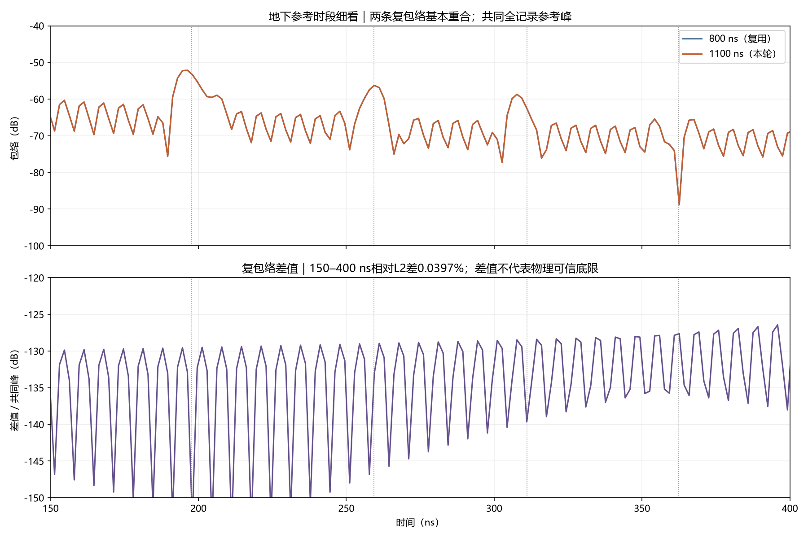
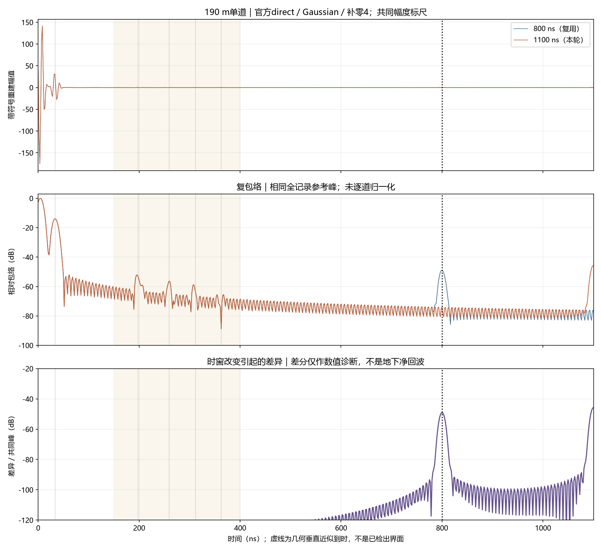

# V3.1：800 ns 与1100 ns单道记录对照

2026-10-12。用户显性批准“批准1100ns单道对照”。新增一次ROG求解，已完成、取回并验收。800 ns结果复用，没有重跑。本批保持CPU单精度，没有扩展B-scan、改变PML或替换现行模型。

预期：仅延长记录，检查800 ns截断对频谱和地下参考时段的影响。实际：前800 ns原生波形逐比特相同；频谱有小幅变化，150–400 ns重建响应基本相同；原生尾部仍未满足官方初筛建议。最明显的重建变化出现在记录截止处。

## 结果

| 核查项目 | 800 ns复用结果 | 1100 ns本次结果 |
|---|---:|---:|
| 原生样本数 | 14283 | 19638 |
| 原生精度 | float32 | float32 |
| 求解阶段耗时，含监督 | 172.296 s | 237.328 s |
| 末5%区间峰值/全记录峰值 | −45.276 dB | −46.348 dB |
| 官方−60 dB尾部建议 | 未满足 | 未满足 |
| 独立DFT/官方复数响应，相对L2差 | 4.92×10⁻¹³ | 5.72×10⁻¹³ |
| 独立逆求和/官方复包络，相对L2差 | 7.93×10⁻¹⁴ | 7.93×10⁻¹⁴ |

两次原生接收波形前14283个样本及源历史前缀逐比特相同，最大绝对差为0。350 m母模型和50 m裁剪模型的材料数组、属性及整个文件字节均相同；材料库、接触面、收发位置、时间步长及原包其余八文件相同。仅复制后的`config/pilot_ascan.json`中800.0改为1100.0。未更改原ZIP。

正式求解仍为gprMax4.0.1、CPU/OpenMP single、50×50 m、2000×2000×1格、2.5 cm网格、HORIPML80、190 m站位、5 m AGL、1.3 m收发间距、内置impulse。材料保持原包论文常数：覆盖层εr12/σ0.003，泥岩18/0.006，砂岩9/0.001，σ单位S/m。

官方SFCW配置仍为direct、20–170 MHz、0.3 MHz、501点、Gaussian默认σ0.2、补零4。源时刻偏移Δt/2，电场接收偏移0。没有尾窗、增益、平移或逐道归一化。它是二维理想线源的场响应，不是有限天线端口S21。

## 频谱和地下时段

以下相对L2定义为`||1100结果−800结果|| / ||1100结果||`。分频段指标比较未加频率窗的官方复数响应；时段指标比较原包Gaussian重建的复包络，先复数相减，再求范数。

| 比较范围 | 相对L2差 |
|---|---:|
| 全部501点复数频谱 | 0.6071% |
| 20–40 MHz | 1.2524% |
| 40–95 MHz | 0.6992% |
| 95–170 MHz | 0.5170% |
| 0–100 ns复包络，直达/地表参考区 | 0.0000720% |
| 150–400 ns复包络，地下界面参考区 | 0.03973% |
| 400–800 ns复包络，含旧截止位置 | 171.96% |
| 800–1100 ns复包络，含新截止位置 | 120.09% |

逐频幅度差最大0.1581 dB，位于35.0 MHz；包裹相位差最大1.0312°，位于28.4 MHz；绝对相位差中位数0.1904°、95百分位0.5918°。这些是本次对照测量值，没有采用为通用物理验收阈值。

150–400 ns覆盖四个地下垂直近似到时：覆盖层底197.7 ns、上泥岩底259.4 ns、下泥岩顶311.1 ns、下泥岩底362.5 ns。它们按5 m空气路径及各层厚度和c/√εr计算，忽略双站偏移、坡度和损耗速度修正；不是已分离回波标签。该区两次重建基本重合，说明本次延长记录没有明显改变这些参考时段的总响应。不能据此认定最深界面已检出，也不能把接近到时的弱峰全部归因到某层。



## 截止处的凸起及其证据

在共同全记录包络峰为0 dB的标尺下，800 ns±15 ns区间峰从−48.90 dB降至−73.94 dB；1100 ns±15 ns区间则从−76.00 dB升至−45.71 dB。后一区间包含1100 ns之后的零延拓重建部分，不是额外记录的原生数据。图中的晚期凸起随记录截止位置改变，支持记录截断产生端点伪峰的解释。晚期区很大的相对差主要受端点凸起影响，不表示整个400–800 ns都发生同等变化。



增量频谱核查进一步定位了变化来源。定义X(f)为实际存储源的DFT，Y₈₀₀(f)、Y₁₁₀₀(f)为两次接收记录的DFT，H=Y/X。两次源前缀相同，新增长度只增加零，因此X相同。把两个H相减得到：

`H₁₁₀₀ − H₈₀₀ = (Y₁₁₀₀ − Y₈₀₀) / X`。

接收前缀也逐比特相同，所以两个Y的公共前缀求和相消，分子只剩新增5355个接收样本的DFT。对这些样本保留原始采样序号和Yee时间偏移，独立求和再除以X，所得增量与官方两频谱之差的相对L2残差为5.40×10⁻¹¹。这是代数与数值一致性检查，表明这次频谱变化由新增记录尾部解释；不是SFCW公式或源相位被改了。

这里仍有两个不同问题：非零尾部在截止处被置零，引起重建端点效应；原生尾部为什么没有充分衰减，尚未归因。此对照只改变时长，没有隔离PML反射、地层晚期返回、格点高频残留或精度效应，不能宣布PML有问题。

## 官方依据与验收边界

[gprMax4.0.1官方SFCW说明](https://docs.gprmax.com/en/latest/inc_SFCW.html)，全文相关章节已核查：Preparing the model、Usage、Frequency and time-window validity。官方要求保留源/接收Yee时间偏移；direct为推荐默认路径。末5%峰高于−60 dB时建议尽可能延长记录；这一建议不是PML归因或完整数值收敛证明。

频率步长0.3 MHz给出周期1/Δf=3333.333 ns，与FDTD记录时长独立。记录之后被假定为零；补零4只细化显示采样，不恢复晚期信息。因此本次结果没有要求把FDTD时窗直接设为3.33 μs，也没有证明1100 ns足够。

下一步建议：先做独立的80格/120格PML单道对照，固定1100 ns及全部其他配置，继续同时检查原生尾部、复频谱和150–400 ns响应。若PML影响小，再单独检查尾部频率与更长记录或精度敏感性；不能只凭尾峰不达标不断加时长。以上是待用户具体批准的新任务，本批没有执行。完整B-scan仍暂缓。

## 交付、哈希与复现

公开图件及机器审计目录：`artifacts/research_checks/2026-10-12_line9_v31_window1100_r2/`。包含五张中文PNG、audit/contract/completion/receipts JSON及复数比较向量NPZ。灰度图只有同站两条单道，不是移动B-scan。所有比较采用共同幅度标尺；对数和放大坐标仅用于显示。

ROG原始输入、输出与日志：`E:\djh\line9_v31_window1100_cpu_20261012_r1`。完整取回副本：`D:\自动处理\artifacts\local_checks\2026-10-12_line9_v31_window1100_r1\retrieved`。两次各15项包内文件及五项日志的SHA-256/大小核验通过；远端completion的SHA-256与取回字节一致。未上传包含原始PDF矢量或场地H5的包。

| 1100 ns文件 | SHA-256 |
|---|---|
| 原生impulse H5 | `b9b7d7e1098c0a53c99103fb36692ab3e4e00820f94c40a63631b9e6da896869` |
| 官方SFCW H5 | `f162eba02475926fa5402da5139622ff8427c0b88dc60dabfe9f3074115f16d7` |
| 远端completion | `5fb582bf374e80b029da56a5af4527c0d9677ff2472894e560d23ccbdd0e73f3` |

分析入口`D:\自动处理\scripts\compare_line9_v31_windows.py`，使用已装匹配官方SFCW工具的Python。以下只读取已取回的两个结果，不启动求解。输出目录须不存在。

```powershell
& 'D:\自动处理\artifacts\local_checks\gprmax_v401_gpu_env\Scripts\python.exe' 'D:\自动处理\scripts\compare_line9_v31_windows.py' --baseline 'D:\自动处理\artifacts\local_checks\2026-10-12_line9_v31_candidate_r1\retrieved' --extended 'D:\自动处理\artifacts\local_checks\2026-10-12_line9_v31_window1100_r1\retrieved' --out 'D:\自动处理\artifacts\local_checks\line9_v31_window_reaudit_new'
```

本批状态：执行及取回完整、输入差异受控、官方SFCW独立数学复算通过。时窗渐近收敛、PML/网格/精度收敛和真实地层检出仍未认证。没有新增120格PML、H0、快照或整线任务。
