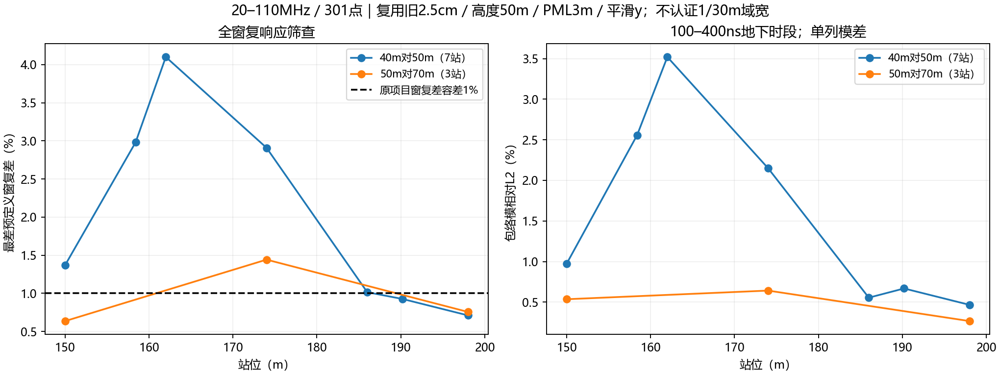
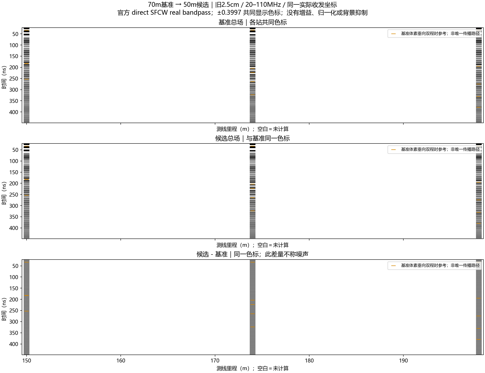

# 横向计算域：新频带下的已有数据复核与受控方案

2026-10-13。用户敲定后续工作频带20–110 MHz，网格精确1/30 m（3.333… cm），平滑y保持。选定配置已记录于[line9_v31_selected_working_configuration_v0_1.json](../../configs/research/line9_v31_selected_working_configuration_v0_1.json)，并接入唯一模型入口。用户选择与数值收敛状态分开记录：此网格已选用，但绝对收敛尚未认证。

本轮预期先复用旧记录，在新频带内查明横向敏感性，为最小补跑方案提供依据。实际新增FDTD为0；ROG只对20份已有原始记录运行官方SFCW：17份2.5 cm域宽记录，另3份1/30 m已有50 m域基准。原材料、源、PML和原始数据未改；旧501点产品完整保留，新301点另存。旧model_current实体没有被新参数改标，待域宽批次具体获批后按归档规则准备新实体。

## 复核范围与结果

横向对照固定高度50 m、底高程410 m、1100 ns、HORIPML物理厚度3 m、平滑y、常数材料、GPU single。40/50 m各7站：150、158.4、162、174、186、190.2、198 m；70 m为150、174、198 m三站。配对收发全局坐标相同。本次没有混入高度45 m对照。

官方direct统一生成20–110 MHz/0.3 MHz/301点、Gaussian、补零4、无尾窗/时移；与旧宽带共同频点的原始复响应相对差均低于1e−10，20份独立DFT及逆求和通过。这是数值处理核验，不是物理域收敛。

| 比较 | 站数 | 全带复谱最大差 | 预定义窗口最大复差 | 100–400 ns最大包络模差 | 原容差筛选 |
|---|---:|---:|---:|---:|---|
| 40 m对50 m | 7 | 0.06395% | 4.1004% | 3.5204% | 未通过 |
| 50 m对70 m | 3 | 0.03427% | 1.4421% | 0.6421% | 未通过 |

50 m对70 m的174 m站：100–400 ns复差1.2128%，最差窗口208.52–238.52 ns为1.4421%，接近上部砂泥岩界面垂向参考时段。新频带没有消除横向敏感性。全带差很小，地下弱响应窗口仍超容差，不能用强直达波加权后的整体相似代替地下保真判断。

灰度三行是70 m总场、50 m总场、50减70 m，同色标；白色表示未计算站位。橙色短线仅为原几何垂向双程时参考。20–450 ns为绘图区间，1100 ns完整记录保留。本组网格为2.5 cm，只用来安排后续1/30 m对照；不能据此认证新网格下50或70 m已经足够。

## 为什么应先查域宽，而不是直接加厚PML

官方说明要求把重要源、观测和散射结构留在物理区，并给源/目标与PML留足距离。15格属于常用布置建议，不是弱地下回波已收敛的保证。[gprMax建模指导，Absorbing boundary conditions](https://docs.gprmax.com/en/latest/gprmodelling.html#absorbing-boundary-conditions)

有三种尚未分离的贡献：①有限离散PML的反射或吸收误差；②裁域使侧方真实地形/地层散射不再参与接收；③倾斜地表和层界面贯穿侧面PML，沿吸收法向材料仍变化。扩大域同时改变这些条件，因此域差不能自动叫作PML回波。

第三项有理论依据。Meep官方文档说明，材料只沿边界平行方向变化，与沿边界法向变化是不同情况；后者可破坏理想坐标拉伸PML的匹配条件。[Meep PML，Breakdown及厚度讨论](https://meep.readthedocs.io/en/latest/Perfectly_Matched_Layer/)。这是相邻FDTD理论依据，不是对gprMax HORIPML的实测故障证明，也不授权切换Meep或新吸收器。

已有连续界面核查支持把这一项列为候选：174 m、50 m居中域左侧3 m PML内，地表高程变化约0.136 m、粉质粘土底变化约0.289 m；在1/30 m网格上分别约4.1、8.7格。说明材料沿侧面吸收方向并非恒定。以上以174 m几何居中为示意；实际1/30 m网格原点还左移1/60 m，具体边界值须按冻结原点生成，不拿示意值冒充新模型验收。

gprMax官方允许调PML阶数、CFS参数和厚度，但这些是独立实验变量。本轮不改变默认一阶HORIPML、不填猜测的alpha/kappa/sigma，也不直接把斜界面在PML前压平。压平或外推会改变散射几何，需要单独许可。[gprMax PML命令](https://docs.gprmax.com/en/latest/input_hash_cmds.html#pml-cfs)

## 几何时间尺度：有可能影响，但不是回波证据

令总域宽为W（m），每侧PML厚度p=3 m，空气波速c=299792458 m/s。收发中心近域中心时，一次到侧面PML入口并返回接收端的水平路程尺度为W−2p：去程约W/2−p，回程约W/2−p，相加得到W−2p。因此空气路径尺度t≈(W−2p)/c。

| W | 空气路径尺度 |
|---:|---:|
| 40 m | 113.41 ns |
| 50 m | 146.77 ns |
| 70 m | 213.48 ns |
| 90 m | 280.19 ns |

这表示假如该处存在反射，因果上可以进入地下分析时段；不证明它存在、振幅多大或主导记录。精确左右侧镜像路径须使用实际TX/RX及PML入口坐标。若仅靠把侧边界可能回返推迟至400 ns以后，则W需约大于c×400 ns＋6 m≈125.92 m；1100 ns则约335.77 m。这是极保守的空气几何尺度，忽略有效吸收，不能当成必须使用的域宽。

因此优先做域宽稳定性对照，接受受控的小残差，而不是把所有边界都推到记录时间之外。

## 建议下一批：最多六次新求解，尚未获批/启动

固定已选20–110 MHz及精确1/30 m，复用150、162、174 m已有50×50 m三站。每站仅新增70×50和90×50 m，共6解。先做174 m的70/90 m两解；若70对90未通过原筛选，停止，不自动扩大域或做其余4解。若通过，再完成150和162 m的4解。

保持同一连续地层、相同实际全局TX/RX坐标、离地高度、材料、原点网格相位、50 m高度、1100 ns、0.95稳定系数、90格/3 m PML、一阶HORIPML、平滑y、4.0.1/GPU0/single/官方单位impulse、direct301点/Gaussian/补零4。扩大域时原点只左移整数个网格，保留区体素和Yee系数必须核查相同。网格及源位置不能再次取整变化。

70 m宽=2100格，90 m宽=2700格，高度均1500格；相比50 m的2.25M格，分别3.15M和4.05M格。时间步与14729样本保持。按已有50 m单站约9–12 s构建求解粗估，本批约2–4分钟、峰值显存约2–4 GiB，批次上限10分钟；不是实测保证。失败即停，不重试、不续跑、不扩整线。旧记录尾部仍高于−60 dB建议，本批只检验在相同1100 ns有限记录下的横向敏感性，不宣称全面时窗收敛。

对50/70/90 m逐站比较未加窗复谱、相位、100–400/400–1000 ns及原几何事件±15 ns窗、包络模、峰幅/峰时，保留原容差。若70对90稳定，再判断50是否也对90稳定，选择已测试范围内最小通过者。90 m只是更宽参照，不是真值；非单调变化、尾部不稳或任一站失败时，不强行冻结域宽。

首次验收为中文三站稀疏灰度、A-scan和逐窗指标；不新增观察点或波场快照。若域宽仍不能稳定，再单独设计固定内物理区、只向外增加PML厚度的对照，以避免加厚PML同时吞掉物理区。该后继任务未获批准。

## 本轮数据与代码留痕

ROG仅官方SFCW重处理20份，24.531 s，零FDTD。第一次处理入口因便携Python未自动把脚本目录加入sys.path，在任何SFCW之前失败；另存research_r2.py修正入口，原入口及修复哈希留痕，运行环境未改。

取回ZIP SHA-256：`bb7ac66e7a3fc6f864deb57fd694bd01d7434b8cb7be09e24c971a429be12642`。原始文件哈希、执行前输入清单及20份原生dtype/样本/dt/收发位置/源半步、官方复谱与独立DFT/逆和通过。[审核摘要](../../artifacts/research_checks/2026-10-13_line9_lateral_domain_research_r1/audit.json)。按实际1/30 m原点与收发坐标生成的左右侧镜像空气路径尺度见[boundary_paths.json](../../artifacts/research_checks/2026-10-13_line9_lateral_domain_research_r1/boundary_paths.json)。分析入口复跑五项结果字节一致。

本地包包含20份复用原始冲激、原宽带及新窄带SFCW、回执/契约/官方处理日志、代码、两张中文图和清单。[完整包索引](../../artifacts/research_checks/2026-10-13_line9_lateral_domain_research_r1/delivery_index.json)。原始和私有模型数据不入Git；旧报告的用户排版改动保留。
