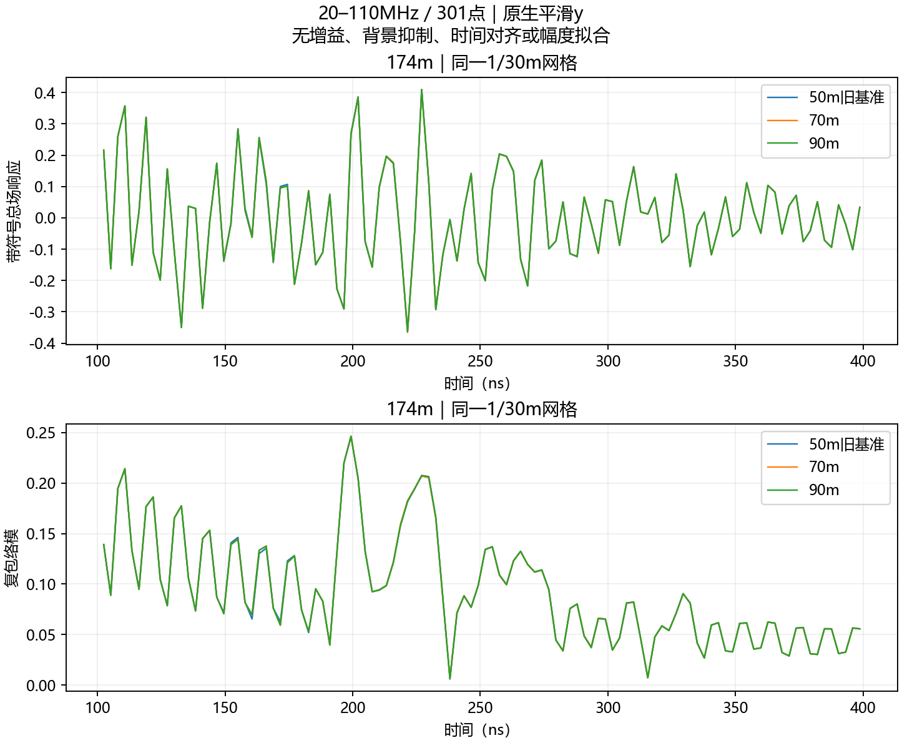
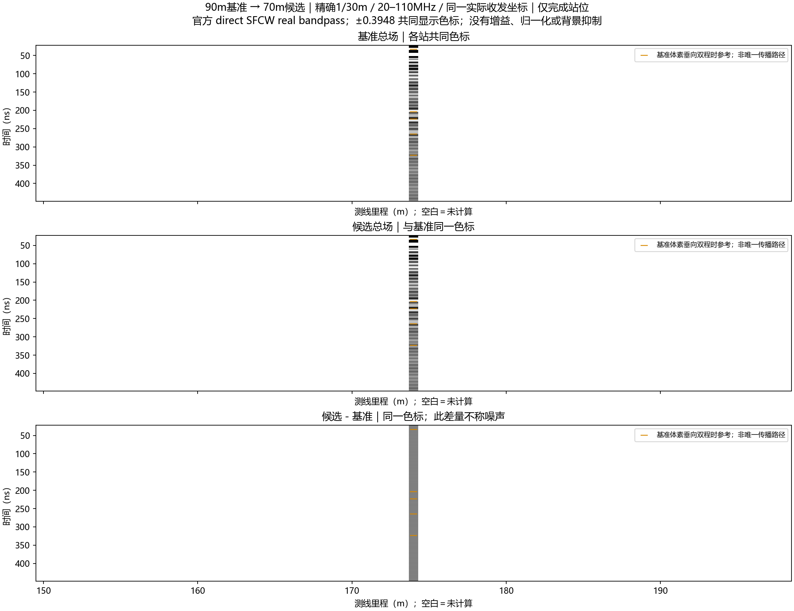
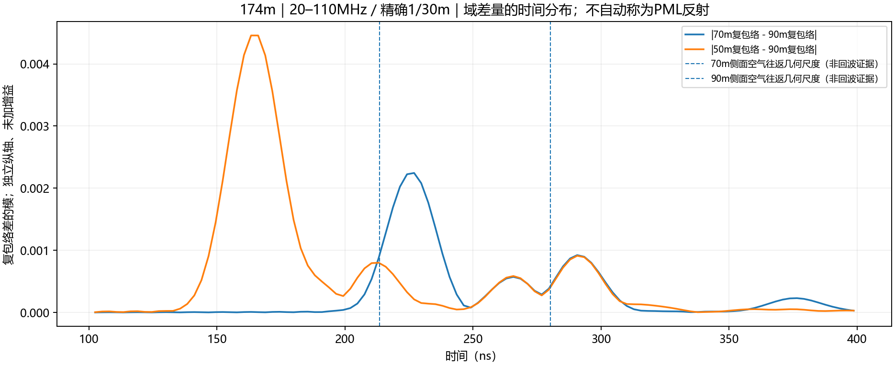

# 精确1/30m横向域对照：174m首组触发停止

2026-10-13。用户批准最多6解：复用150/162/174 m的50×50 m，只新增每站70×50与90×50 m，先验174 m两解；70对90未通过原容差即停止。本轮**实际新增2解，均求解成功；原保真筛选未通过，余下4解未启动，零重试**。未自动采用新域宽，未扩展B-scan。

## 条件与执行前检查

固定精确`1.0/30.0` m、20–110 MHz/0.3 MHz/301点、原四种常数材料、相同实际全局TX/RX和网格相位、约5 m离地、50 m高度/底高程410 m、1100 ns/14729样本、0.95稳定系数、3 m/90格一阶HORIPML、平滑y、gprMax4.0.1/GPU0/single、官方单位impulse/direct/Gaussian/补零4，无尾窗、时移、增益、背景抑制或响应拟合。未修改官方场更新核。[冻结契约](../../artifacts/research_checks/2026-10-13_line9_lateral_domain_r1/frozen_contract.json)

70/90 m分别为2100×1500和2700×1500格。域原点仅左移10/20 m（300/600格），实际收发坐标不变，水平间距仍1.3 m，沿用原1/30 m基准的垂向坐标。先由同一连续界面生成90 m域，再取70 m切片；全部6个准备候选保留的50 m体素与原几何逐格一致。地表ROI实际导出的Ez介电常数和电导系数也与旧基准逐点一致；没有另外导出整个保留区全部Yee分量，不能把局部导出核验写成全域系数测量。

首次本地准备在启动前被一个过严检查拦下：上部泥岩底折线只在上部泥岩存在范围内有定义，覆盖检查却要求它跨越整个扩大域。改为只核查原存在范围后通过；分类规则、材料、地层没有改变，旧50 m重建始终相同。失败准备目录及更正记录保留，没有发生失败FDTD或重跑。

## 结果：接近容差，但没有通过

所有比较均以表中较宽域为有限参照。没有把90 m当解析真值。

| 指标 | 70对90 m | 50对90 m | 50对70 m |
|---|---:|---:|---:|
| 全带复谱L2 | 0.007786% | 0.009010% | 0.015291% |
| 强频点相位RMS | 0.003648° | 0.004258° | 0.007189° |
| 100–400 ns复包络L2 | 0.5471% | 1.0696% | 1.1930% |
| 100–400 ns包络模L2 | 0.2915% | 0.6923% | 0.7280% |
| 208.52–238.52 ns复包络L2 | **1.0928%** | 0.3254% | 1.3039% |
| 308.28–338.28 ns复包络L2 | 0.06586% | 0.15967% | 0.17084% |
| 400–1000 ns复包络L2 | 0.05931% | 0.05712% | 0.05206% |

原项目容差保持：全带复差≤0.5%、强频点相位RMS≤0.5°、各预定义窗口复差≤1%、峰幅差≤1%、峰移≤2 ns。本组70对90只有208.52–238.52 ns窗口复L2超过1%；该窗峰幅差0.2737%、峰移0，其余项目通过。原门槛由项目选择，不是官方统一物理标准。本轮没有因为1.0928%接近1%就放宽或跳过。

实测执行门禁与本地独立复算逐项一致，正确触发停止。50对90在该窄窗反而比70对90接近，但100–400 ns仍略超1%。这是非单调干涉差异，不能据“偶然更接近90 m”宣布50 m更准确或仅靠加宽一定收敛。[完整逐窗结果](../../artifacts/research_checks/2026-10-13_line9_lateral_domain_r1/comparisons.json)

灰度只画实际完成的174 m，余处白色为未计算，不作整线插值。各图三行是90 m基准总场、候选总场、候选减90 m；共同色标，短线为原几何垂向双程时参考。绘图区间20–450 ns，完整1100 ns原始记录与全周期重建都在本地包。

## 传播归因与实际限制

70减90 m复包络差量在100–400 ns中于约227.02 ns最强。70 m侧面PML入口的居中空气往返尺度约213.48 ns，90 m约280.19 ns；前者靠近差量所在时段，但不是反射检出证据。官方有限带宽重建有双侧展宽/旁瓣，倾斜地层的侧向传播和域外被裁掉的真实散射也可能影响同一时段。差量没有按来源分离，不能直接命名为PML回波。[官方SFCW频率及时窗说明](https://docs.gprmax.com/en/latest/inc_SFCW.html#frequency-and-time-window-validity)

当前较强证据是：地下总波形在三档域宽下相当接近，局部弱响应还有约百分之一的横向敏感性；较深308–338 ns窗口对70→90 m更稳定。不支持“所有地下结构都被侧面反射破坏”，也不认证某条回波已唯一对应某界面。更宽域改变PML位置及参与传播的侧方地质，仍未分离二者贡献。

70/90 m原生末5%尾峰分别−46.49/−46.38 dB，均高于官方−60 dB建议。旧50 m为−46.25 dB。此次仅在相同1100 ns记录下检验横向敏感性，不认证完整时窗/精度/域收敛。[官方FDTD及PML指导](https://docs.gprmax.com/en/latest/gprmodelling.html#absorbing-boundary-conditions)

后续建议优先做一个独立边界对照：保持内物理区及收发坐标固定，只向外增加侧面吸收层，避免加厚PML同时缩小物理区。其参数及地层在新吸收区的延拓必须另行敲定。本轮没有执行这项新任务，也不自动扩大到更宽域、修改CFS参数或启动快照。

## 执行、核验及交付

70/90 m各一次FDTD为12.2482/15.4888 s，构建加求解18.8447/22.1116 s；合计FDTD27.7370 s、构建加求解40.9563 s，含官方SFCW及首组验收墙钟46.6410 s。90 m日志估计主机620.2 MB、设备约1.8 GB，不是实测峰值。没有声称重复性能基准。

ROG：`E:/djh/line9_lateral_domain_20261013_r1`。取回ZIP SHA-256：`93a57922a4e870fb97c1ecf5878361a3f8ae43e7943c58125b4a9dda178c9e87`，本地一致。16项新回执文件、执行前输入清单、原生float32/14729样本/dt/源与接收半步偏移/实际位置/地表ROI系数核验通过；2新加3旧共5项独立11频点DFT与31时点逆和通过，最大相对差约8.52e−13/2.04e−14。150/162 m的4个新候选无attempt文件，未误算作完成。见[audit.json](../../artifacts/research_checks/2026-10-13_line9_lateral_domain_r1/audit.json)。

包内分析复跑7项输出逐字节一致。完整本机包含2新＋3旧原生/窄带SFCW、6个冻结候选几何、材料/契约/回执/日志、实际工作代码及分析、4张中文图与清单。[包索引](../../artifacts/research_checks/2026-10-13_line9_lateral_domain_r1/delivery_index.json)。原始/私有几何不入Git。

本轮授权单元已按停止规则完成。保持用户选定20–110 MHz＋精确1/30 m＋平滑y；横向域宽仍待选择，旧model_current实体未替换。已保留旧CPU试跑报告的用户排版修改，不纳入本轮提交。
