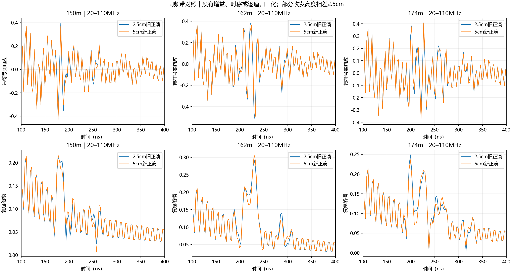
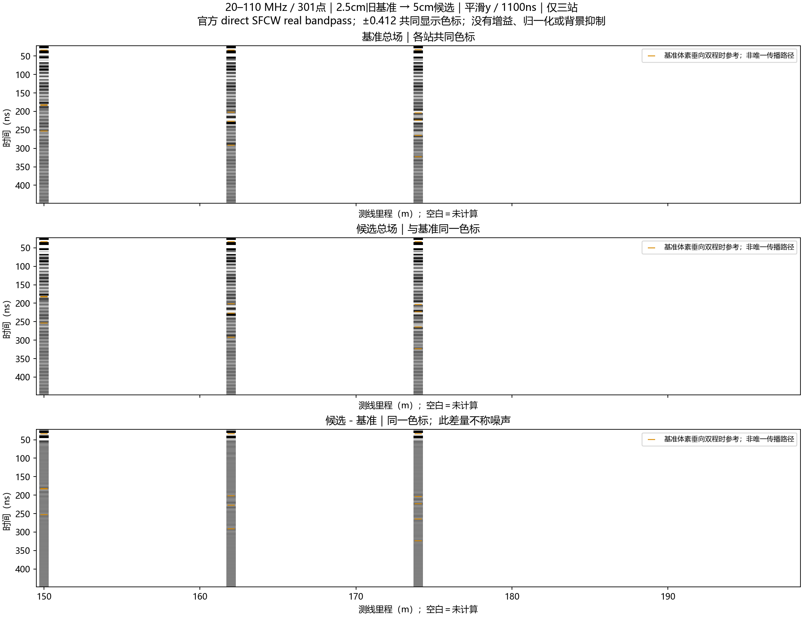
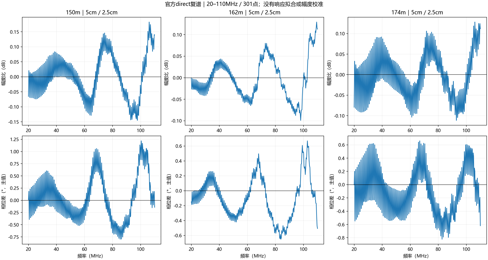
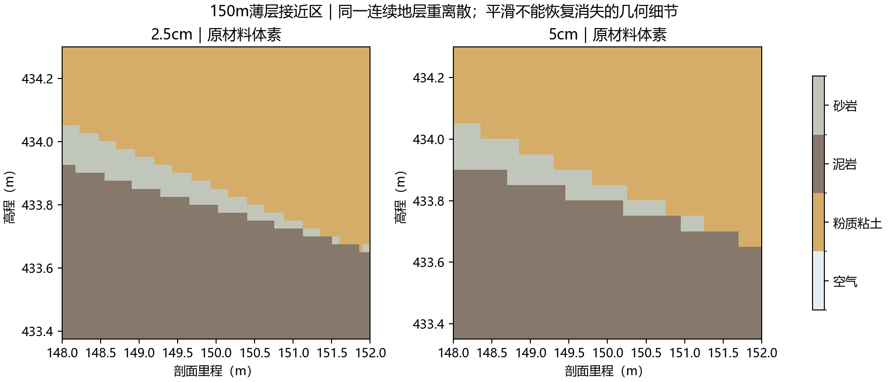
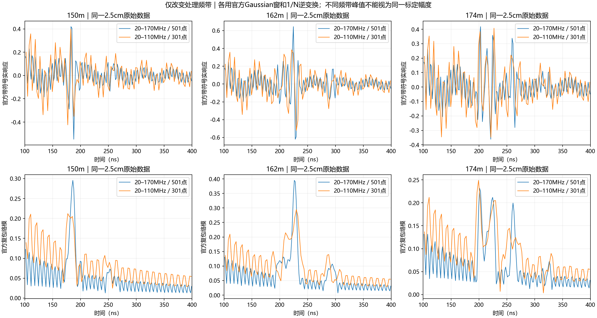

# 20–110 MHz＋5 cm：复用2.5 cm原始数据的三站验证

2026-10-13。用户取消了尚未启动的1/30、1/60、1/120 m／1600 ns收敛方案，转向验证20–110 MHz＋5 cm。用户随后指出2.5 cm已有结果。本轮据此只新增150、162、174 m各一次5 cm正演；三站2.5 cm完全复用原始impulse.h5，不重新求解。**5 cm明显加速，但三站都未通过原冻结保真容差，不能据此改为长期默认网格。**

## 实际执行与复用

执行前冻结契约：[frozen_contract.json](../../artifacts/research_checks/2026-10-13_line9_v31_band110_grid5cm_r1/frozen_contract.json)。ROG目录`E:/djh/line9_v31_band110_grid5cm_20261013_r1`。新批3次求解，零重试；没有启动此前建议的三次精网格收敛对照，也没有新增2.5 cm求解。

原始2.5 cm基准来自已完成的原生平滑/域对照批`full_x150.0_y`、`full_x162.0_y`、`full_x174.0_y`。源H5、旧501点SFCW及原回执/求解日志保留。重新生成的2.5 cm体素与旧三站逐格相同；母模型未换。随后用官方CLI从原始冲激直接生成301点SFCW，没有截取旧时间波形，也没有以FFT掩码替代官方direct。

两档均为V3.1场地适配候选、二维TMz理想z向线源；50×50 m域、底高程410 m、名义离地5 m、水平收发间距1.3 m、1100 ns、稳定系数0.95、HORIPML物理厚度3 m、原生平均y、gprMax4.0.1/GPU0/single、单位内置impulse。材料全为原包常数：空气εr1/σ0，粉质粘土12/0.003，泥岩18/0.006，砂岩9/0.001，电导率单位S/m，无Debye。新档1000×1000格、PML60格；旧档2000×2000格、PML120格。

两档SFCW均为官方direct、20–110 MHz、0.3 MHz步长、301点、Gaussian、补零4，无尾窗、无时移、无增益或背景抑制。未替换`model_current/`及正式20–170 MHz配置。

| 站位 | 新TX相对旧TX垂向变化 | 新RX相对旧RX垂向变化 | 域及水平位置变化 |
|---|---:|---:|---|
| 150 m | +2.5 cm | +2.5 cm | 无 |
| 162 m | 0 | +2.5 cm | 无 |
| 174 m | 0 | +2.5 cm | 无 |

新坐标按最近网格点、正半格向上规则在执行前冻结，没有按结果拟合平移或相位。本轮比较包含体素重离散和垂向取整。失败不能唯一归因于数值色散；这也是复用旧结果的明确限制。

## 同一20–110 MHz内的粗网格差异

| 指标 | 150 m | 162 m | 174 m |
|---|---:|---:|---:|
| 全带复谱相对L2 | 1.2252% | 0.8486% | 0.9602% |
| 强频点相位RMS | 0.4691° | 0.3003° | 0.3709° |
| 100–400 ns复包络相对L2 | 13.1446% | 13.5351% | 14.5026% |
| 100–400 ns包络模相对L2 | 7.1281% | 7.2887% | 7.7591% |
| 预定义窗口最差复L2 | 22.2694% | 22.3394% | 23.9162% |
| 原生末5%尾峰 | −42.70 dB | −40.75 dB | −42.57 dB |
| 旧基准末5%尾峰 | −45.24 dB | −50.56 dB | −48.14 dB |
| 单次构建＋求解时间比 | 3.86倍 | 11.52倍 | 10.86倍 |

仍使用原项目筛选：全带复差≤0.5%、强点相位RMS≤0.5°、每预定义窗复差≤1%、峰幅差≤1%、峰移≤2 ns。三站均未通过。容差是保守项目选择，不是官方通用标准；全带指标由较强响应加权，不能代表地下弱响应保真。[逐窗结果及实际阈值](../../artifacts/research_checks/2026-10-13_line9_v31_band110_grid5cm_r1/comparisons.json)

150 m约238–268 ns窗口出现19.38 ns的最大包络峰位置差。多峰干涉时，最大值可能在竞争峰之间切换；不能把此数直接解释为某个界面的真实到时偏移。301点补零4后的显示时间间隔约2.76855 ns，原2 ns峰移阈值小于一格；本轮未放宽该阈值，且不通过结论独立地由复谱及窗口L2支持。

灰度图显示20–450 ns，三行是2.5 cm总场、5 cm总场、5 cm减2.5 cm；共同色标，空白为未计算站位。橙色短线仅标原几何的垂向双程时参考，不是对响应的唯一来源认定。完整1100 ns原始记录和全周期重建均保留在本地包。

150 m中心列砂岩最薄体素段仍为5 cm，在新网格上只有1格；说明“每波长格数够用”不能代替薄层和界面几何核查。平滑改善界面系数，不能恢复被体素化丢失的几何细节。

## 缩窄频带是另一项变化

在同一份旧2.5 cm原始数据上分别对比20–170 MHz/501点和20–110 MHz/301点。共同301个频率的未加窗复响应相对差小于1e−10；原始数据复用及官方direct在共同频率上自洽。这不代表两种加窗时间波形相同。

带宽从150 MHz减至90 MHz。相同传播速度下，名义分辨尺度与1/带宽成正比，因此新尺度/旧尺度=150/90≈1.67，即分辨尺度变粗。Gaussian也随频带重新定义，中心从95 MHz移到65 MHz，不能等同于仅删掉旧已加窗频谱的高频部分。各档保留官方1/N逆变换归一化；不同带宽的峰幅不能直接作为同一标定下的回波强度或SNR增益。

0.3 MHz间隔没有变，重建周期仍1/0.3 MHz≈3333.33 ns。此周期不表示FDTD实际求解到3333 ns；实际只有1100 ns。新重建1204点，旧2004点；补零不能补回带宽、薄层几何或晚期未记录的传播。[官方SFCW输入、频率与时窗有效性](https://docs.gprmax.com/en/latest/inc_SFCW.html)

110 MHz、泥岩εr18的低损近似波长为c/(f√εr)≈0.6424 m。除以5 cm得到约12.85格/波长，满足官方常见十格初筛，但这是初筛而非收敛证明。当前地下窗口仍有超容差差异，与初筛不矛盾。[官方FDTD建模指导](https://docs.gprmax.com/en/latest/gprmodelling.html)

## 执行、核验与交付

三项累计FDTD5.2469 s、官方构建加求解11.3095 s，含官方新旧SFCW处理批墙钟20.3992 s。相对旧基准，构建求解中位比约10.86倍；包含首项编译/缓存及跨批差异，是单次观察，不能用来保证整线耗时。

ROG取回ZIP SHA-256：`ba17de415f504ebcc8212439327b4cab0e17d1829ba7aa1038b6efe149cc94da`，本地一致。42项新/复用回执文件的大小与SHA-256、执行前输入清单、原始float32、9820/19638样本、dt、收发位置、源半时间步偏移和实际混合Ez介电系数均通过。3新窄带＋3旧窄带＋3旧宽带共9项独立11频点DFT和31时点逆求和通过，最大相对差约1.13e−12/6.47e−14。见[audit.json](../../artifacts/research_checks/2026-10-13_line9_v31_band110_grid5cm_r1/audit.json)。

代码只增加显式`--band110-grid5cm`准备模式、按冻结契约调用官方SFCW、301点验收及本轮分析；原501点默认和原始处理约定保持。旧六项粗网格的比较JSON和五图重算逐字节一致。完整包复跑分析的全部7项输出逐字节一致，包内输入与数据按清单重新核验。

完整本地包及哈希见[delivery_index.json](../../artifacts/research_checks/2026-10-13_line9_v31_band110_grid5cm_r1/delivery_index.json)。包含3新＋3旧原始冲激、新旧窄带和旧宽带SFCW、几何/材料/契约/日志、分析与复现入口、五张中文图和SHA清单。私有体素和原始结果不入Git。

结论限定为：本组合有明显计算优势，但尚未通过本项目保真筛选。旧2.5 cm基准本身也不是绝对真值，且两档尾峰均未达官方−60 dB建议。当前不修改默认网格、不扩整线、不再做1/30 m续研；若要进一步区分坐标取整与网格误差，应另行敲定匹配实际收发坐标的少量对照，当前未启动。
