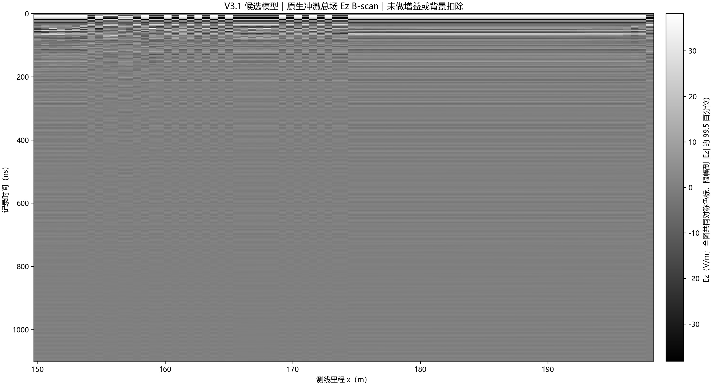
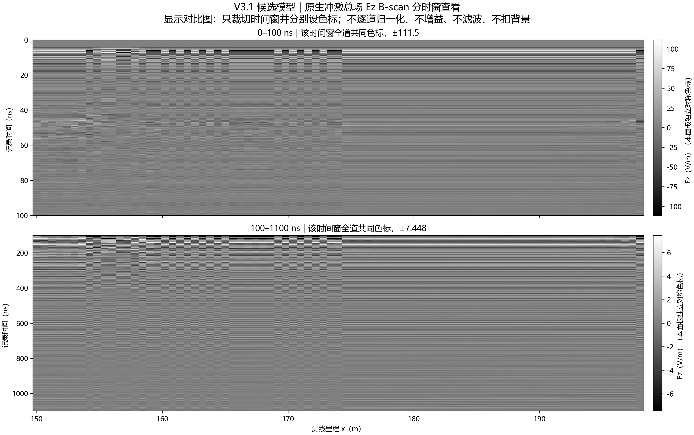
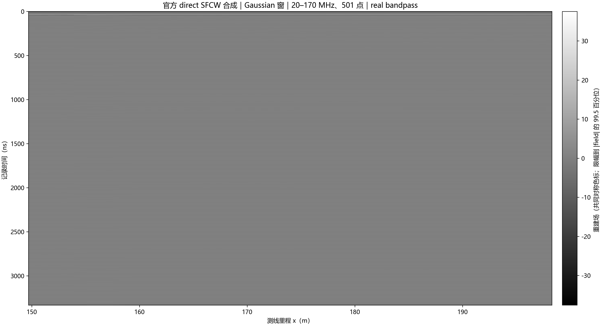
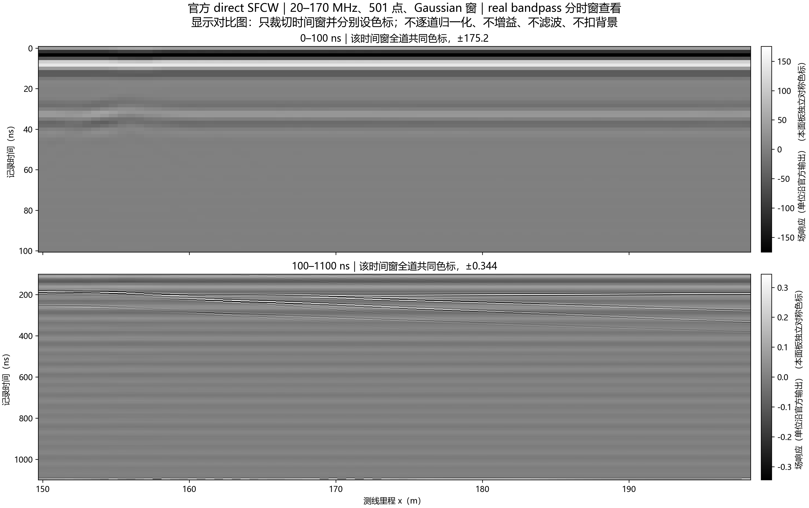

# V3.1 候选模型 150–198 m GPU B-scan

**状态：81 道计算与文件验收通过；官方建议的末尾衰减初筛未通过；不是实测验证。**

## 本轮执行

用户批准在 ROG 上用 GPU 运行 150–198 m 测线，并为 7 小时上限适度减道。将原计划的 97 道、0.5 m 间距改为 81 道、0.6 m 间距；两端仍为 150 m 和 198 m。扫描覆盖长度没有缩短。

本轮使用 V3.1 的二维 TMz 候选模型，不是 `current_model.json` 指向的现行三维模型。保留原包材料、几何、源和官方处理约定；没有改模型电性、网格、时窗或边界。参数如下：

| 项目 | 本轮值 |
|---|---|
| 求解器与硬件 | gprMax 4.0.1；ROG NVIDIA GeForce RTX 4090 Laptop GPU，设备 0 |
| 精度 | GPU single；原生接收数据 float32 |
| 测线 | 150–198 m，81 道，0.6 m 等间距 |
| 模型域与网格 | 50 m × 50 m，0.025 m 网格 |
| 天线高度 | 离地 5 m；理想 z 向 Hertzian dipole，接收 Ez |
| 记录时窗 | 1100 ns；19638 个原生样本；Δt=56.018 ps；最后采样时刻 1100.026 ns |
| PML | x、y 四面各 120 格；z 两面 0 |
| 材料 | 原包常数基线：覆盖层 εr=12、σ=0.003 S/m；泥岩 εr=18、σ=0.006 S/m；砂岩 εr=9、σ=0.001 S/m；未作场地标定 |
| 激励 | gprMax 内置 unit impulse |
| SFCW | 官方 direct；20–170 MHz、501 点、0.3 MHz 步进、Gaussian 窗、补零 4；未加 tail taper、未作时间平移 |

gprMax 官方手册说明，single 是 CPU 与加速器求解的默认精度，通常也有较好的 GPU 性能；本轮记录显示实际选择了 CUDA GPU 0 和 single，而不是仅凭“机器有 GPU”推定。[官方加速器与精度说明](https://docs.gprmax.com/en/latest/accelerators.html)

官方 SFCW 工具从宽带冲激响应合成逐频响应；`direct` 方法是推荐路径，并支持把合并后的多道 B-scan 一次处理。[官方 SFCW 手册](https://docs.gprmax.com/en/latest/inc_SFCW.html) [官方合并工具说明](https://docs.gprmax.com/en/latest/inc_Utilities.html)

## 运行与文件验收

81 道全部成功。正演用时 1960.1 秒，完整批次含合并与 SFCW 用时 1963.3 秒（32 分 43 秒），平均每道 24.20 秒，低于 7 小时上限。没有失败道或重跑道。第一次启动时 Windows CUDA 主机编译器未进入进程环境，求解尚未开始；随后仅在本次进程初始化已安装的 Visual Studio 编译环境，未改系统 PATH 或模型参数，最终批次正常完成。

独立验收核对了 81 个逐道 HDF5 文件及其回执 SHA-256；原生合并矩阵为 `(19638, 81)`、float32、全有限值；direct SFCW 复响应为 `(501, 81)`、重建时间响应为 `(2004, 81)`，全部有限，频率从 20 MHz 到 170 MHz、步进 0.3 MHz。源历史在 81 道间哈希相同。合并文件 SHA-256：`311ea121f8dc8f8d95051e25433b4b829e4d0d1e0ff9bbc8c7c347b46ce7e87c`；SFCW 文件 SHA-256：`a94e46e09ccc5bf390bd94b395d82aaa841b5aa6abde91233564ee50034ea45b`。

来源追溯有一个命名差异，已保留并记录：实际成功运行根目录是 `_r2`，但提交到该根目录的 `resolved_contract.json` 仍带 `_r1` 后缀，完成清单本身没有 `task_id` 字段。报告据实际 `_r2` 根目录、81 份 PASS 回执和全部逐道/合并/SFCW 哈希绑定结果；未改写原始契约。[核对说明](../../artifacts/research_checks/2026-10-13_line9_v31_bscan150_198_gpu_r2/provenance_reconciliation.json)

## 图件

全记录图使用每幅图内统一的全道线性色标，不逐道归一化、不增益、不滤波、不扣背景。强早时响应压缩了晚时显示动态范围；分时窗图只改变显示窗口与每个面板的共同色标，不改变波形。不同面板的数值色标不可直接比较。

分时窗 SFCW 图中可见约 180–260 ns 的连续倾斜事件。这只是图上观测；本轮没有叠加地质界面真值，也没有把它归属为泥岩、砂岩或滑动面。

## 时窗限制

按官方手册建议，对每一道计算最后 5%（982 个样本）峰值相对该道全记录峰值：81 道都高于 −60 dB 初筛线；范围 −55.91 至 −42.97 dB，中位数 −44.59 dB，90 分位数 −43.19 dB。gprMax 官方 direct SFCW 程序本身也报告合并接收尾部 −43.5 dB，并给出超过 −60 dB 的告警。这个结果说明 1100 ns 尾部尚未通过官方建议初筛；它不能单独证明求解失败，也不能把原因归为 PML。官方手册建议在最后 5% 超过 −60 dB 时尽可能延长记录。[官方时窗与尾部说明](https://docs.gprmax.com/en/latest/inc_SFCW.html)

本批频率步进 0.3 MHz 对应 SFCW 周期 `1/Δf = 3333.33 ns`，因此 SFCW 文件的 2004 点时间响应约显示到 3331.67 ns；这不是 3.33 μs 的 FDTD 记录。官方工具说明，超过已记录 FDTD 响应的样本按零处理，补零只细化显示采样，不增加带宽、分辨率或缺失的晚期信息。因此，1100 ns 之后的 SFCW 周期区间不能解释成新增的真实传播记录。

此前单道 1100→1600 ns、固定 PML120 的对照也没有通过尾部初筛：尾峰从 −54.80 dB 回升到 −50.36 dB。结合本次 81 道全部高于 −60 dB，不应据此直接扩成整线 1600 ns 求解；空间变化、有限模型回波和时窗效应仍需区分。当前成果是一个已完成的 V3.1 候选 B-scan 和官方 SFCW 数值产品，不是现场性能验证，也未证明地层界面检出。

## 交付与复现证据

- 运行摘要、逐道验收表、图件色标审计和来源命名核对见 [`artifacts/research_checks/2026-10-13_line9_v31_bscan150_198_gpu_r2/`](../../artifacts/research_checks/2026-10-13_line9_v31_bscan150_198_gpu_r2/)。
- 含 81 道原始 HDF5、合并 HDF5、官方 SFCW HDF5、回执及四张图的本机包：`artifacts/local_checks/2026-10-13_line9_v31_bscan150_198_d05_r1/deliverable/line9_v31_bscan_150-198m_81traces_1100ns_PML120.zip`（20,932,112 字节；SHA-256 `b7156bcbcf9c2c0dd4d2ebba603f1424414e1e7283766b8b309da9ac8d484234`）。数据包保留在本机；Git 入库本报告、摘要审计和图件。
- 本轮使用 1100 ns/PML120。之前的 1100→1600 ns 为单道对照，已独立完成；不是本次 81 道 B-scan 的时窗。现行模型指针未改。
