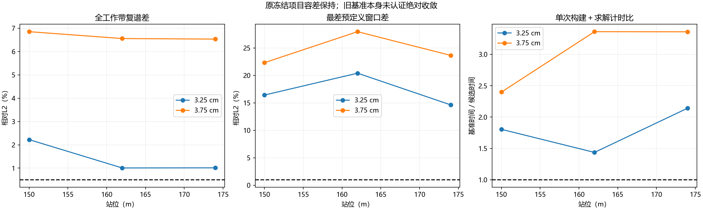
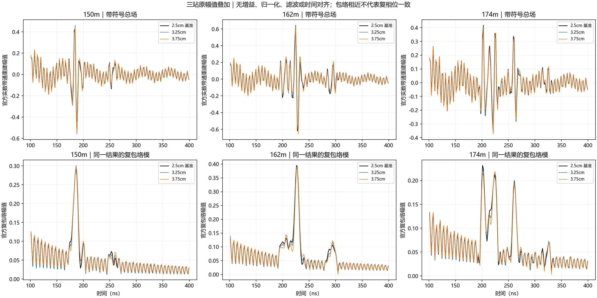
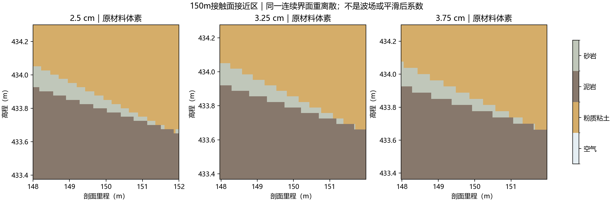
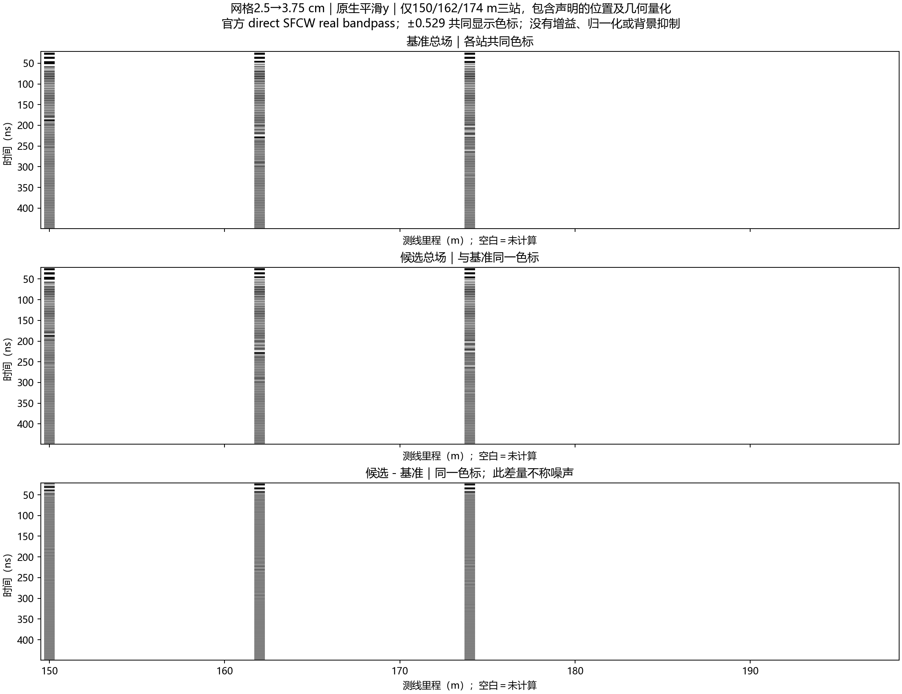

# V3.1粗网格验证：更快，但尚不能直接替代2.5cm

2026-10-13。用户在粗网格对照建议后指示“开始验证”。ROG六项全部完成且未重跑，复用三站已验收的2.5cm平滑结果。**实际提速成立；3.25cm与3.75cm均未通过原冻结替代筛选，当前不采用。** 此结论针对包含几何和坐标取整的实际替代方案，不证明所有粗网格方法都不可行。

## 预期与实际

预期：保留完整SFCW，检查较粗网格是否能保持关键响应并缩短正演。实际：3.25cm与3.75cm的FDTD中位加速分别约2.17/3.47倍，含构建的中位比约1.80/3.36；但100–400ns地下响应及其相位存在明显变化，不能以视觉相近替代误差验证。物理域、源位置和介质边界的量化也参与差异，尚未单独隔离。

## 执行不变量与量化

150、162、174m，各3.25/3.75cm，共6次新FDTD。gprMax4.0.1、RTX4090Laptop GPU0、single/原生float32；1100ns、稳定系数0.95、原常数材料（覆盖层ε12/σ0.003，泥岩ε18/σ0.006，砂岩ε9/σ0.001 S/m）、平均y、官方单位impulse/direct20–170MHz/0.3MHz/501点、Gaussian/补零4均保持。无滤波、增益、时间对齐、源谱拟合或结果归一化。现行模型及所有历史包未改。

所有界面从同一连续地层折线重新离散。准备时先重新生成2.5cm几何，三站与旧几何逐体素完全相同；再生成粗网格，另以嵌套分类独立核对材料赋值。没有通过重复粗体素制作“细网格真值”。详见[冻结方案](2026-10-13_line9_v31_coarse_grid_plan.md)。

| 网格 | 实际域宽×高 | PML格数/物理厚度 | 原生点数 | 水平收发间距 |
|---|---|---|---:|---:|
| 2.5cm基准 | 50×50m | 120 / 3m | 19638 | 1.3m |
| 3.25cm | 50.0175×50.0175m | 93 / 3.0225m | 15107 | 1.3m |
| 3.75cm | 50.025×50.025m | 80 / 3m | 13093 | 1.275m |

底面高程仍410m。域向上取整，以名义站位居中；源/接收按最近格点取整，半格向正方向。3.25cm两天线水平共同偏移+1.625cm；3.75cm发射/接收水平偏移分别+1.25/−1.25cm。垂向偏移最大1.5cm，详见冻结契约每案的坐标差。没有按结果补偿这些差异。因此这是实际粗化整体敏感性，不是严格同坐标、同PML入口的纯网格色散实验。

## 精度与耗时

原项目筛选值保持：全频复L2≤0.5%、强频点相位RMS≤0.5°；100–400ns、400–1000ns及独立旧几何参考到时±15ns各窗复L2≤1%、峰幅差≤1%、峰移≤2ns。它们是本轮保守替代容差，不是官方统一标准。

| 指标（三站） | 3.25cm | 3.75cm |
|---|---:|---:|
| 全工作带复谱相对L2范围 | 1.008%–2.222% | 6.532%–6.851% |
| 强频点相位RMS最大 | 0.800° | 3.513° |
| 100–400ns复包络L2范围 | 9.276%–13.232% | 14.653%–19.515% |
| 所有预定义窗口最差复L2 | 20.414% | 27.971% |
| 100–400ns仅包络模L2范围 | 4.536%–5.787% | 8.189%–10.672% |
| FDTD中位加速 | 2.173倍 | 3.469倍 |
| 构建＋求解中位加速 | 1.804倍 | 3.359倍 |
| 三站全部通过原筛选 | 否 | 否 |

最差窗口均出现在162m底部泥岩—砂岩几何参考时段276.47–306.47ns。3.25/3.75cm该窗峰幅差分别约9.44%/15.11%；峰时未移动也不代表响应相同。

174m的3.75cm结果在100–400ns全窗最大包络峰位置改变23.29ns，但多个事件幅度接近，最大峰可换选另一事件；**不能把这个数当作地下界面传播时延改变23ns**。预定义窄窗及完整波形比全窗单峰更适合比较。

六项累计FDTD更新时间48.2695s，官方构建＋求解66.7333s，批次墙钟78.844s。单项含包装约7.5–16.5s。加速比来自本次粗网格与旧批基准的单次计时，包含缓存/编译/机器状态影响，未做重复统计，不保证整线耗时。

六项原生末5%尾峰为−48.64至−43.90dB，仍高于官方−60dB初筛建议。粗化没有取得尾部收敛；原2.5cm基准也未全面认证，不能把它当绝对真值。[官方网格与记录有效性](https://docs.gprmax.com/en/latest/inc_SFCW.html#frequency-and-time-window-validity)

包络模去掉相位信息，所以其差异小于复响应差异；两者不可互换。图中主事件大体仍在，不是全部回波消失，但若要保留弱结构与相干杂波的关系，当前差异不能直接忽略。

## 几何证据与中文稀疏B-scan

150m中心列的砂岩薄体素段由基准5cm变为3.25cm网格的6.5cm、3.75cm网格的7.5cm。各网格中心列的采样位置也略不同；这是接触面接近处的离散几何，不是现场薄层厚度测量。图可见局部薄段连续性和边界位置随重离散改变。该证据支持存在几何量化影响，但不能量化其占全部回波差异的比例。

白色区域表示没有计算，不插值成连续B-scan。每组三行分别为基准总场、候选总场、候选减基准，使用同一色标；差量不称噪声。频谱幅度比及相位图另见 `complex_spectrum_comparison.png`。

## 验收与交付

远端取回ZIP SHA-256为 `3485d4f3a10eabbb48a7c6a5b76c53f7b5e0972bc046ca9084be5f6b78eba995`。本地核对69项新/旧回执文件的大小和哈希；6新＋3旧原生源/接收元数据、float32、样本、dt、源半dt时间偏移、单位单样本impulse及GPU日志通过。六项原生Yee导出均含混合介电边，平均实际启用。

九份复谱各抽11个频点显式DFT、各抽31个时间点显式逆和，最大相对误差约1.92e−12/6.48e−14。数值链一致不表示粗网格通过物理精度筛选。来源/精度/比较分别保存在 `audit.json`、`comparisons.json`、`envelope_diagnostic.json`。

完整本地包：`artifacts/local_checks/2026-10-13_line9_v31_coarse_grid_r1/delivery/line9_v31_coarse_grid_6solves_20261013.zip`。含6新＋3旧冲激/SFCW、实际几何/材料/冻结契约、日志/回执、分析及执行代码、六张中文图、SHA-256清单和复核说明；原始资料/几何包不上传Git，图件和审计摘要入库。包体哈希见公开 `delivery_index.json`。

## 当前决定

保留默认介电平均y和2.5cm正式网格、官方impulse/direct全频带。3.25/3.75cm此次整体替代不采用；不追加求解，不通过增益、对齐或放宽阈值掩盖差异。后继如继续追求加速，应先设计能更好保留垂向界面和实际收发位置的网格对照，再单独检查传播误差；这只是建议，未启动。没有证据需要放弃SFCW，也不能据本批把此前实测差距归因于某一个因素。
