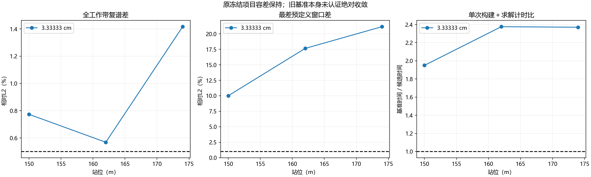
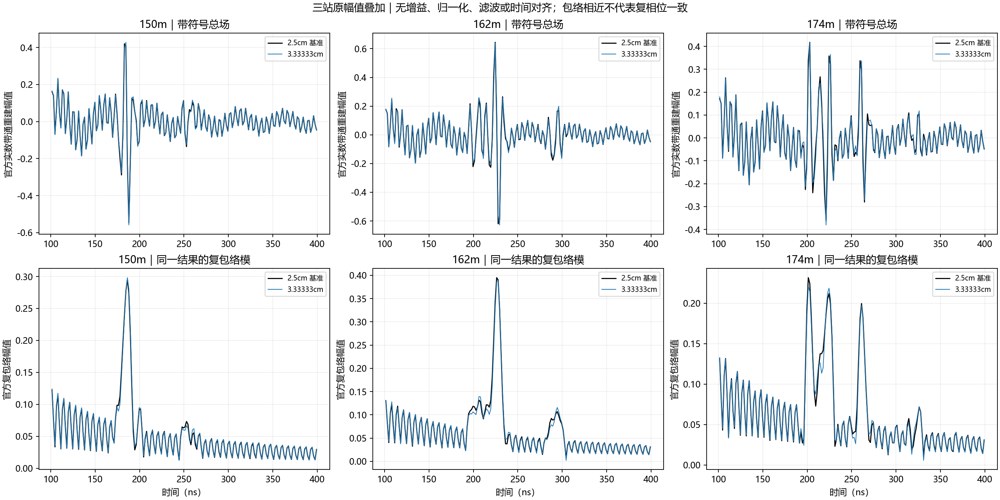
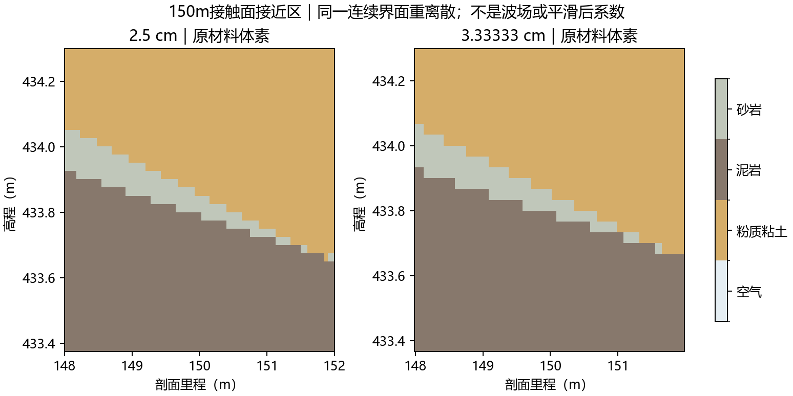
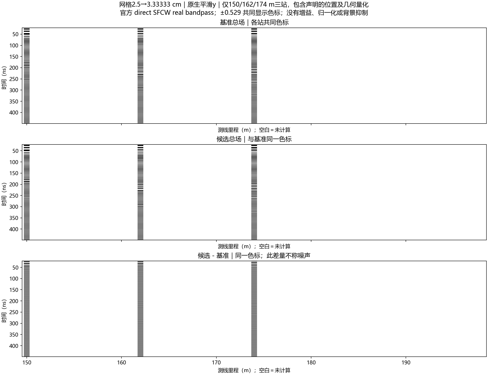

# 精确1/30m网格：三站结果

2026-10-13，用户指定“网格尝试1/30 m，即3.333…cm”。已在ROG完成150、162、174m三次新求解，复用2.5cm/y三站，零重跑。**构建＋求解中位加速约2.37倍，但未通过原冻结替代筛选，暂不采用为正式网格。**

## 精确步长和对齐

实际API参数直接由 `1.0/30.0` 计算，为双精度浮点可表示值0.03333333333333333；契约另外保存分子1/分母30。没有使用0.0333。图例中的3.33333cm只是显示位数。

1500×1500格正好50×50m；90格PML正好3m；收发水平间距为39格、1.3m。因为39是奇数，原居中域中两个天线均位于半格，解析选择网格原点左移1/60m，使两个天线的全局水平坐标与旧基准一致（浮点差≤3e−14m）。域边界也随之左移约1.667cm，长度不变。底面仍410m。

| 站位 | 发射垂向取整差 | 接收垂向取整差 |
|---|---:|---:|
| 150m | −0.8333cm | −0.8333cm |
| 162m | 0 | −0.8333cm |
| 174m | +1.6667cm | +0.8333cm |

这些差异在求解前冻结，没有按结果拟合平移、相位、源强度或增益。因此本轮减少了水平坐标、域长度和PML厚度取整因素，仍包含地层重离散、垂向取整和边界平移影响，不能称纯网格色散实验。所有地层来自同一连续界面；重新生成2.5cm三站均与旧体素逐格相同。

材料、平均y、gprMax4.0.1/GPU0/single/原生float32、1100ns、0.95稳定系数、官方单位impulse/direct20–170MHz/0.3MHz/501点、Gaussian/补零4保持；不滤波、不加增益、不做时间对齐或归一化。现行模型未改。见[执行前方案](2026-10-13_line9_v31_grid_1over30_plan.md)。

## 相对2.5cm/y基准的结果

| 指标 | 150m | 162m | 174m |
|---|---:|---:|---:|
| 全带复谱L2 | 0.7734% | 0.5683% | 1.4165% |
| 强频点相位RMS | 0.2761° | 0.2309° | 0.5712° |
| 100–400ns复包络L2 | 6.2853% | 11.5609% | 15.6443% |
| 100–400ns仅包络模L2 | 3.8175% | 5.4296% | 6.0163% |
| 所有预定义窗口最差复L2 | 10.0108% | 17.6451% | 21.1527% |
| 原生末5%尾峰 | −47.44dB | −44.03dB | −46.25dB |

仍使用原全带≤0.5%、强频点相位RMS≤0.5°、每预定义窗复L2≤1%/峰幅差≤1%/峰移≤2ns等项目容差，没有放宽。三站均未通过；174m最差窗为249.55–279.55ns，接近上下砂泥岩接触面参考时段，而不是原记录尾部。各窗口/峰幅/峰时详见公开 `comparisons.json`。

相较3.25cm，150m和162m的多数差异下降，174m反而增加。因此不能仅凭“尺寸整除”认定1/30m更准确，也不能把上一轮的全部误差归于水平天线间距。全带差主要受强信号权重影响，地下弱窗需单列检查。

150m中心列薄砂岩体素段由原5cm变为6.6667cm；边界与薄段连续性仍受离散影响。中心列采样位置并不完全相同，这不是现场薄层厚度测量。未单独隔离几何、垂向坐标、数值色散和边界各因素，不能给出它们的贡献比例。

三行分别为2.5cm基准总场、1/30m总场、候选减基准，共同色标；白色表示没有计算，不作整线插值，差量不自动称噪声。`complex_spectrum_comparison.png` 单列幅度比和相位。

## 执行、验收与交付

三项累计FDTD更新时间26.6723s、官方构建加求解33.3206s，批次墙钟39.3304s。相对旧三站的FDTD/构建求解中位加速分别2.4197/2.3705倍，是单次跨批观察，不是重复性能基准。每项原生14729点float32；频谱501点、重建2004点，后者不代表1100ns之后实际求解。

远端取回ZIP SHA-256 `cbd33ab94cbbab99645fae74b7efe4e264f891427e783711aa94148b10c568f7` 与本地一致。45项新旧回执文件大小/哈希，6份新旧结果的元数据/源时间偏移/独立11频点DFT和31时点逆和通过，最大相对差约1.24e−12/6.48e−14；原生混合介电系数证明平均已启用。三条尾峰仍高于官方−60dB建议，旧基准也尚未认证绝对收敛。[官方记录与频带有效性](https://docs.gprmax.com/en/latest/inc_SFCW.html#frequency-and-time-window-validity)

代码仅增加显式 `--spacing-fraction 1/30` 模式及按契约案例数/网格作分析；默认旧模式不变。用更新后的分析复核旧六项，比较JSON及五张图逐字节一致，旧审计源代码哈希保留在历史包中，不改旧证据。

完整本地包：`artifacts/local_checks/2026-10-13_line9_v31_grid_1over30_r1/delivery/line9_v31_grid_1over30_3solves_20261013.zip`，含3新＋3旧原生/SFCW、输入几何/材料/契约/日志/代码、五图及SHA-256清单，包哈希见公开 `delivery_index.json`。原始/私有几何仅本机交付，报告和图件入库推送。

当前仍保留2.5cm正式网格、默认平滑及官方完整SFCW，不自动扩大批次或更换激励。整除解决了一部分对齐问题，尚未解决整体回波保真问题。
