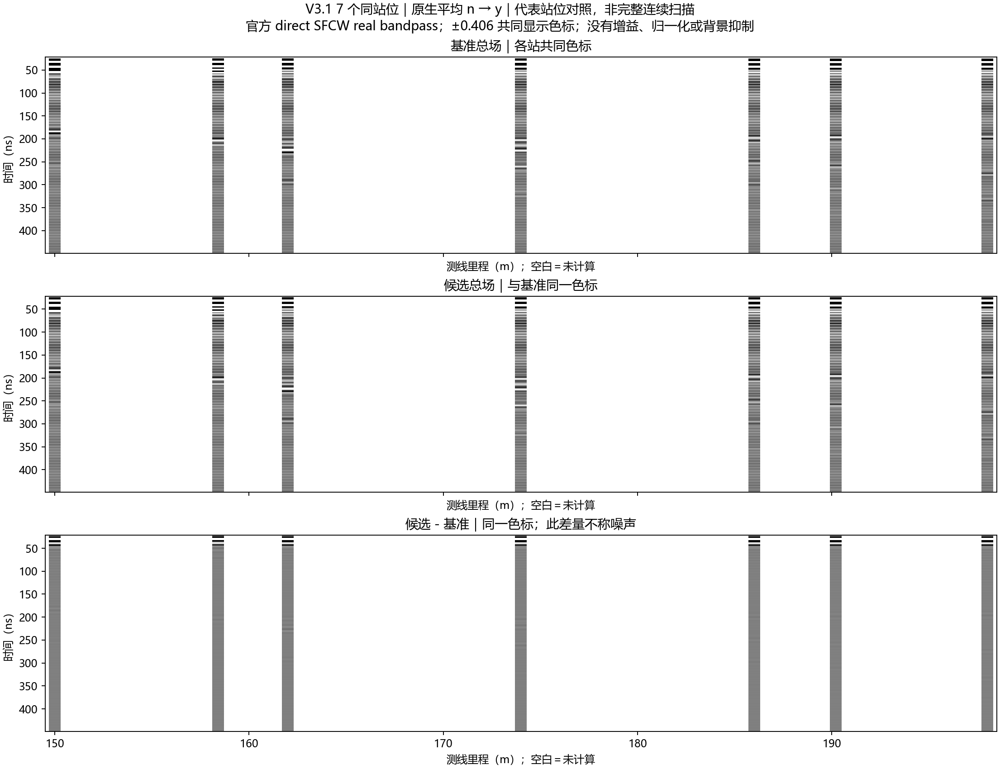
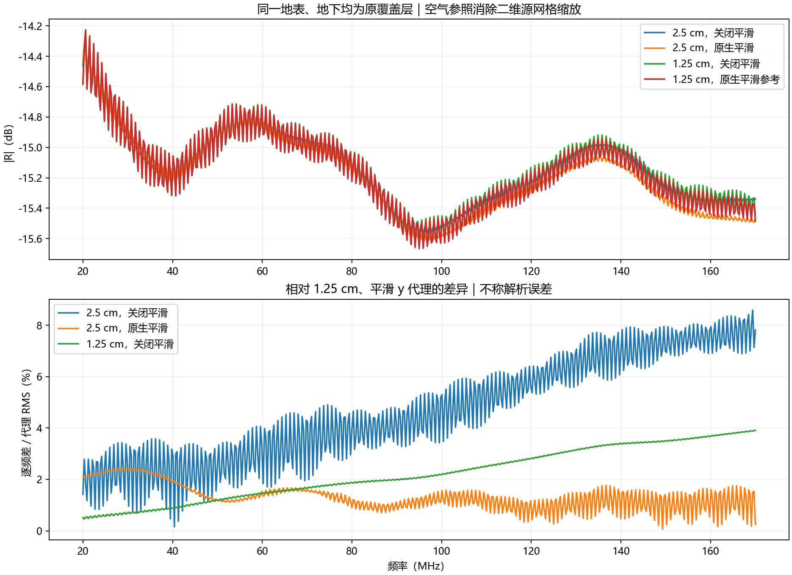
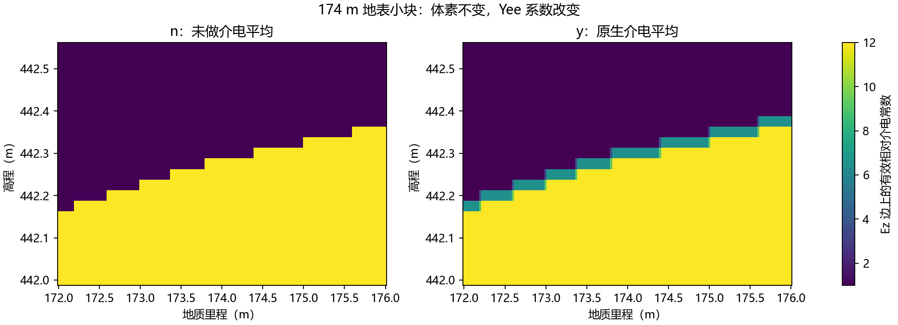
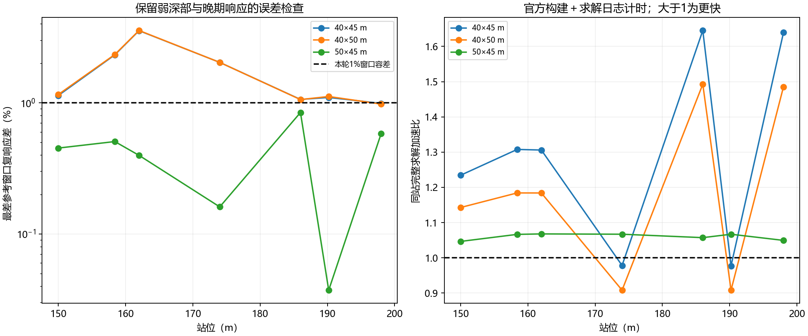
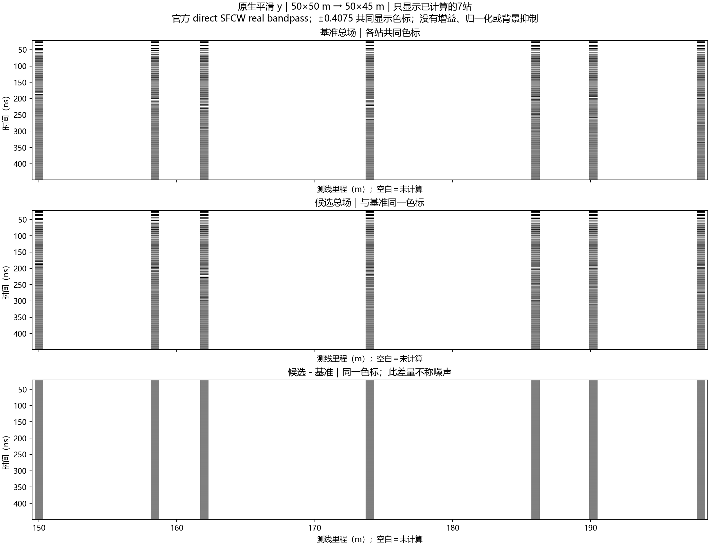
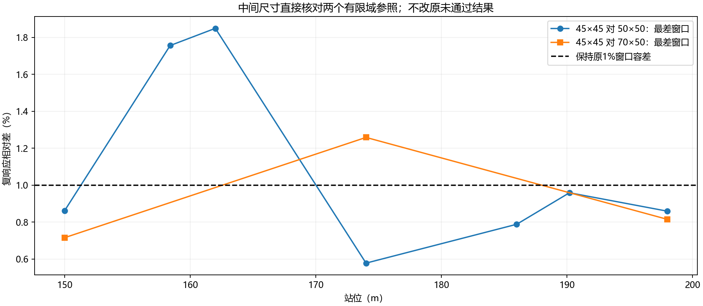

# V3.1 原生介电界面平滑与缩域：结果及交付

日期：2026-10-13。用户授权先检查原生平滑，再优化计算域；随后要求先打包结果，自行分析。实际完成 **44 次新 FDTD 求解、1 次 geometry_only 构建**，复用原 81 道中的 7 站。没有替换现行模型，也没有采用新的生产配置。

## 预期与实际

预期：用官方介电平均减小台阶离散的影响；在固定材料、源、收发绝对位置和正式 SFCW 的条件下，检查缩域是否能保持响应并节约时间。

实际：官方平均确实改变界面 Yee 系数；粗网格结果更接近细网格的平滑代理。只裁顶部空气的 50×45 m 对原 50×50 m 通过本轮局部筛选，但约只节约 6% 时间。横向缩域的局部响应差异较大；原 50 m 宽域自身对 70 m 参照也有超过 1% 的窗口差异。因此没有候选同时满足原定局部筛选和扩大域检查，不能声称已证明缩域不影响传播物理。

## 不变量与对照

- gprMax 4.0.1；ROG RTX 4090 Laptop GPU 0；GPU single，原生 float32。官方更新核没有修改。
- V3.1 独立二维 TMz 候选。空气 εr=1、σ=0；覆盖层 εr=12、σ=0.003 S/m；泥岩 εr=18、σ=0.006 S/m；砂岩 εr=9、σ=0.001 S/m，均无 Debye。不要与现行三维/Debye模型混用。
- 理想 z 向 HertzianDipole、官方单位 impulse；接收 Ez，沿测线收发间距 1.3 m，标称 5 m 离地。每个站位的收发全局坐标保持不变。
- 1100 ns；常规网格 2.5 cm、19638 点；地表细网格诊断 1.25 cm。稳定系数 0.95。HORIPML 物理厚度 3 m，对应 120/240 格；不变轴两面为 0。
- 官方 direct SFCW：20–170 MHz、步长 0.3 MHz、501 点；Gaussian、补零 4。无尾窗、时间移位、增益、滤波或逐道归一化。复响应是 Ez/源电流历史的响应，不是端口 S21。
- 2004 点重建的周期为 3333.33 ns；这不代表 FDTD 实际计算到了该时间。

7 个完整地层配对站为 150、158.4、162、174、186、190.2、198 m。它们来自原 81 道的索引 1、15、21、41、61、68、81；索引从 1 开始。图中白色间隔表示未计算区域，不能解释为零回波。

| 组别 | 新 FDTD 数 | 说明 |
|---|---:|---|
| 全地层平滑 y | 7 | 对应旧 n 的 7 站 |
| 单地表及空气网格对照 | 6 | 158.4 m；两网格各 n/y 地表及空气 |
| 70×50 m 扩大域 | 3 | 150/174/198 m，平均 y |
| 50×45、40×50、40×45 m | 21 | 各 7 站，平均 y |
| 45×45 m 中间域 | 7 | 单独父哈希契约，平均 y |
| 合计 | 44 | 另有 174 m 的 n 静态系数构建，无 FDTD |

原条件性 30×45 m 未执行。40 m 宽和扩大域检查未通过后，剩余 7 解用于中间宽度 45×45 m；保留原未通过判定及全部容差。准备阶段 30×42.5 m 因顶部净空不足被拒绝，尚未启动求解。见[执行方案及有界补充](2026-10-13_line9_v31_smoothing_domain_plan.md)。

## 平滑结果

H5 为纯体素导入，官方 `GeometryObjectsRead(averaging="y")` 支持界面平均；这不是地表坐标平滑或后处理滤波。[官方 API](https://docs.gprmax.com/en/latest/input_api.html)

174 m 同一地表小块的体素完全相同。关闭平均时，Ez 介电系数只有 1、12；开启后出现 3.75、6.5、9.25，共 169 个 Ez 边位置改变。证明平均实际生效，不代表几何台阶被移除。

地表单独诊断将地下全部替换为原覆盖层，保留同一连续地表，并以各网格的空气响应消除二维源强度缩放：先以正式复谱作差 `H_surface-H_air`，再除以同网格 `H_air`，得到无量纲诊断 R。该 R 不替换任何正式 SFCW 文件。

相对 1.25 cm、y 细网格代理，2.5 cm、n 的带内复数相对 L2 为 **5.1313%**，2.5 cm、y 为 **1.4148%**，差异减少约 3.63 倍。但细网格 n/y 本身还差 **2.4368%**；对细网格 n，粗网格 n/y 分别差 2.8246%/2.7553%。因此这是对选定细网格代理的改善，不能称解析真值、绝对收敛或全部非物理散射已消除。

全地层 7 站 y 对旧 n：完整工作带复谱变化 0.9853%–1.6360%；100–400 ns 复包络变化 3.8469%–6.0158%。平均影响所有介电界面，不能将这些变化全部归于地表。7 站开启平均后的原生末 5% 尾峰为 **−50.56 至 −42.68 dB**，仍未达到官方建议的 −60 dB 初筛线，平滑没有解决尾部残留。[官方 SFCW 说明](https://docs.gprmax.com/en/latest/inc_SFCW.html)

## 计算域结果

域尺寸按宽×高列出；底面固定高程 410 m。裁顶只删除空气；横向裁切只取同一母模型的整数格切片。相同物理位置的地表系数核对相同。边界移近仍可能改变有限域响应，故需扩大域对照。[官方 FDTD/PML 说明](https://docs.gprmax.com/en/latest/gprmodelling.html)

预先固定的项目筛选值：完整复谱 L2≤0.5%，强频点相位 RMS≤0.5°；100–400、400–1000 ns 以及几何垂直到时±15 ns 各窗复包络 L2≤1%、峰幅差≤1%、峰移≤2 ns。它们是本轮设计容差，不是官方标准，也不是地质检出的门槛。

| 域（m） | 相对 50×50 m 最大复谱差 | 最大窗口差 | 7站局部筛选 | 含构建/求解中位加速比 |
|---|---:|---:|---|---:|
| 50×45 | 0.3073% | 0.8424% | 通过 | 1.0665 |
| 40×50 | 0.0510% | 3.5552% | 未通过 | 1.1840 |
| 40×45 | 0.3057% | 3.5436% | 未通过 | 1.3059 |
| 45×45 | 0.2897% | 1.8486% | 未通过 | 1.1366 |

40 m 宽两组最差差异发生在 **162 m 的 100–400 ns**，不是只影响晚期。50×45 m 的 ≤400 ns 地下参考窗最大差约 0.1607%，晚窗最大 0.8424%；含构建/求解约节约 6.24% 时间。计时为各站单次对照的中位比，没有重复性能基准，不能作为其他设备或大批次的保证。

原 50×50 m 对 70×50 m 的 3 站扩大域检查，在 **174 m 的 100–400 ns 差 1.1515%**，超过原 1% 容差。50×45 m 对 70×50 m 同站差约 1.1573%；45×45 m 对 70×50 m 最大窗差 1.2581%。原参照自身尚存在有限域敏感性。因此即使 50×45 m 对原域局部通过，也没有满足本轮完整采用条件。

其余图件：`stage_B/domain_40x50_sparse_bscan.png`、`stage_B/domain_40x45_sparse_bscan.png`、`stage_mid/mid45x45_sparse_bscan.png`，均位于上述公开证据目录，使用共同色标和固定物理坐标。

## 执行与验收留痕

44 解累计 FDTD 更新时间 **1364.1065 s（22分44秒）**；官方构建加求解时间合计 **1526.7072 s（25分27秒）**。这不是包含传输、分析和停顿的整个会话墙钟时间。

两次包装审计在成功求解后停止：第一次把官方源 excitation 组误当数据集；第二次计时解析器不支持官方“分钟+秒”格式。修正为官方 `load_source` 和多单位计时解析。原输出、原工作脚本和失败留痕保留，以原 H5/日志哈希恢复审计；**没有重复 FDTD 求解**。这两项缺少包装墙钟，使用官方完成日志计时并明确标注，不冒充全流程计时。

验收包括 345 项回执文件的大小/SHA-256、冻结契约绑定、原生 float32/样本/时间步/源与收发位置、保留几何与界面系数；44 项正式复谱各抽 11 个频点显式 DFT，重建各抽 31 个时点显式逆求和，误差均低于 1e−10。该数值一致性不等于时窗、精度和 PML 渐近收敛或现场有效性。完整摘要见公开目录的 `delivery_audit.json`，逐项结果见各阶段 `audit.json`。

## 交付与复核

本地完整包：`artifacts/local_checks/2026-10-13_line9_v31_smoothing_domain_r1/delivery/line9_v31_smoothing_domain_44solves_20261013_r2.zip`。交付前已从包目录复跑三个分析入口，18 项 JSON/PNG 与归档结果逐字节相同。R2 修正先读说明中静态案例的名称；原始 H5、契约和数值结果不变，首版 ZIP 本机保留。

包括 44 份原生冲激和 44 份未经改写的官方 SFCW H5、7 份旧基线原生 H5与旧完整 SFCW、45 项系数导出/日志/回执、已使用的体素几何、冻结契约、材料配方、实际工作脚本版本、分析代码、中文图和 SHA-256 清单。不含原始实测 CSV、PDF 或钻孔资料，不需要这些资料即可复算本轮分析。基线完整 SFCW 文件保留原 81 列；基线配对表明确选取的 7 列。

包内 `README_先读.md` 给出 HDF5 字段、阶段映射和只读复核命令。ZIP 的大小和哈希单列在公开 `delivery_index.json`，避免自引用。原始 HDF5/几何包仅本机交付；Git 保存代码、契约、报告、图件和审计摘要。

用户要求先自行分析。当前维持原配置，不扩展 B-scan，不推广平均或任何缩域尺寸，不自动新增求解。
