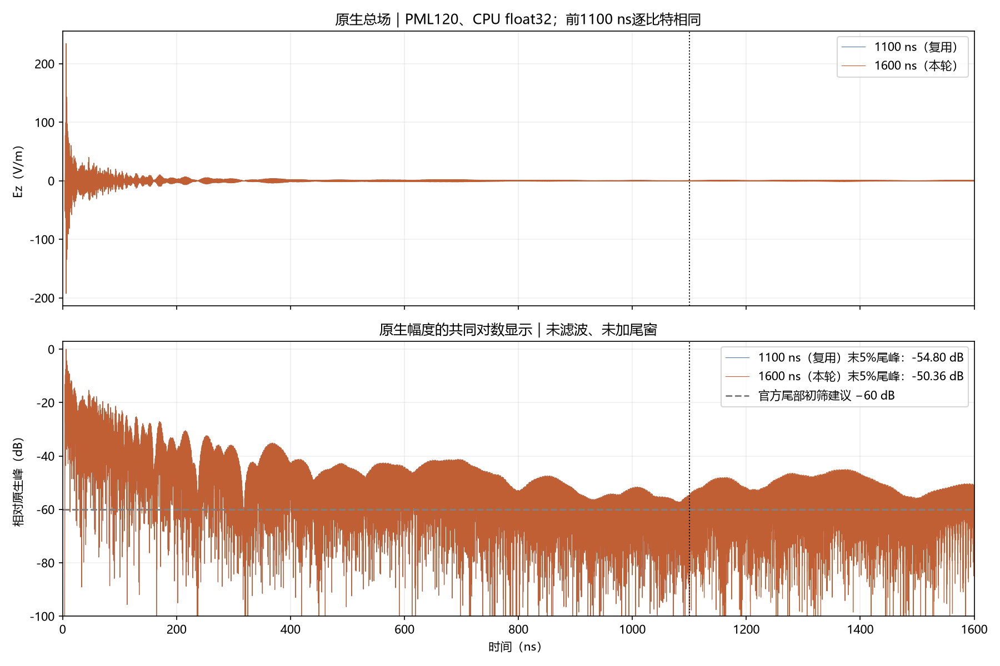
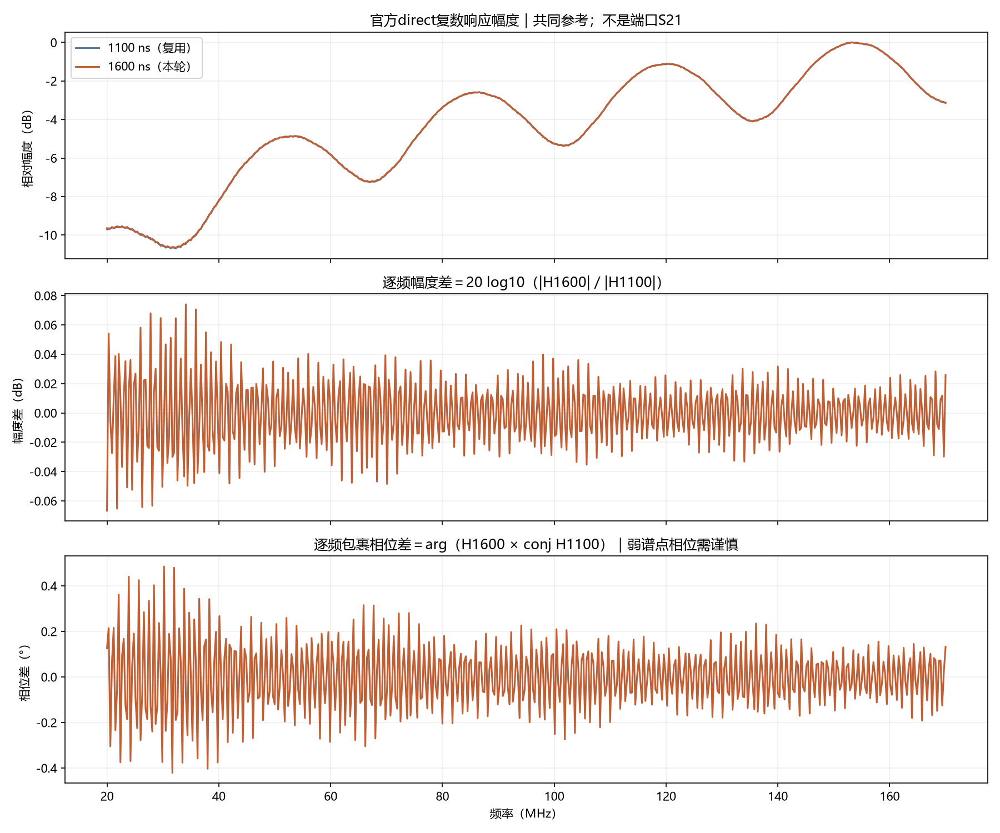
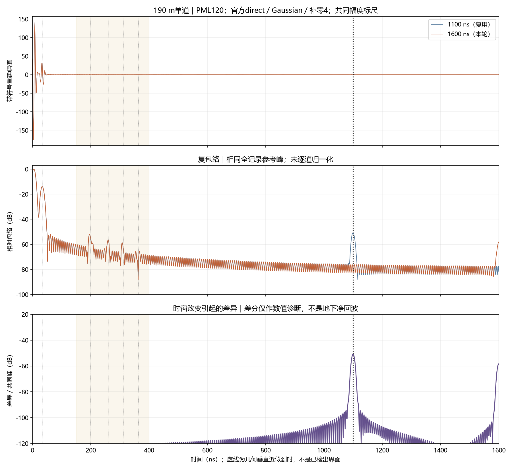
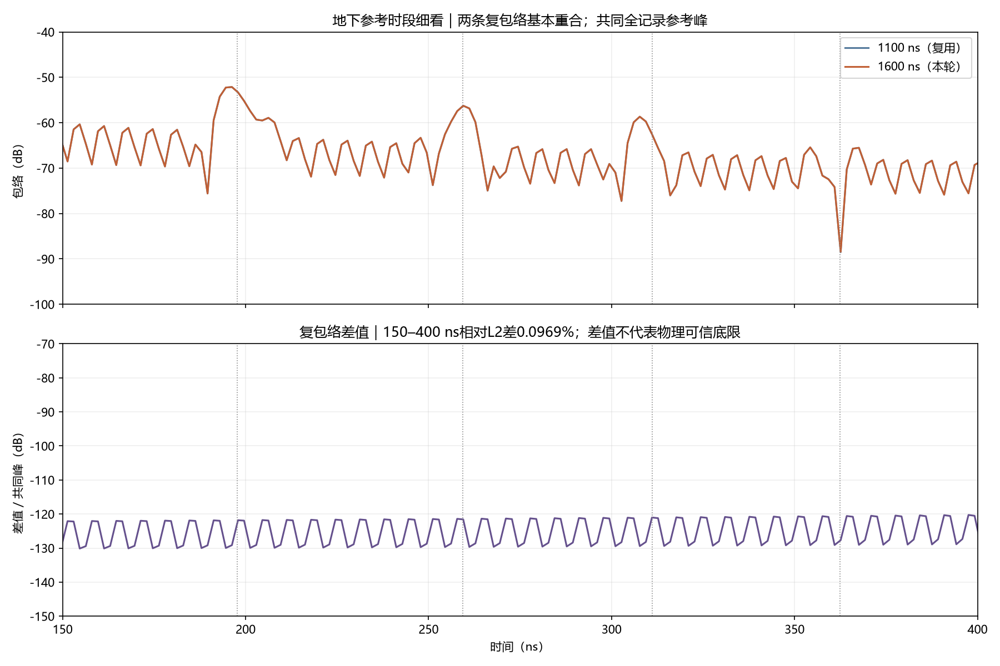
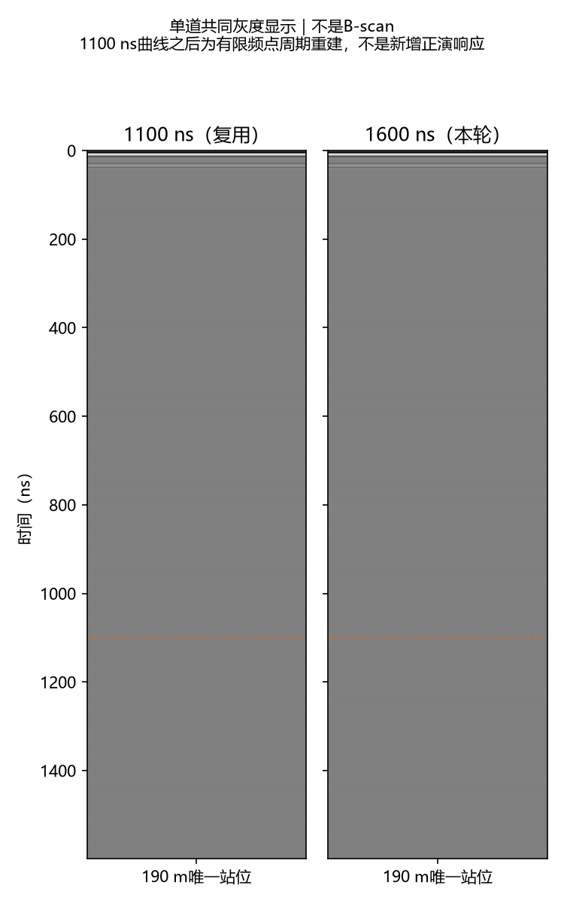

# V3.1：固定PML120，1100→1600 ns受控单道对照

2026-10-13。用户选中具体方案“固定120格PML，单独比较1100→1600 ns”并明确指示“开始”。本单元仅新增ROG一次CPU单精度求解，复用1100 ns/PML120；准备、验收、图件及提交推送包含在该授权内。

预期：隔离有限记录截断对原生尾部、官方SFCW工作带和固定地下参考窗的影响。实际：前1100 ns源和接收记录逐比特一致；末5%尾峰由-54.796变为-50.358 dB，仍未达到官方−60 dB尾部初筛建议；501点复谱相对变化0.302096%，150–400 ns复包络变化0.096935%。本对照没有改变材料、源、PML或正式处理方法。

## 配置、运行与独立验收

保持V3.1独立候选：50×50 m二维TMz、2000×2000×1格、2.5 cm网格、190 m站位、约5 m离地、沿测线1.3 m收发、HORIPML四面120格（3 m）、z两面0。覆盖层εr12/σ0.003、泥岩18/0.006、砂岩9/0.001，σ单位S/m；均为原包非色散常数。理想二维HertzianDipole z分量、官方内置单位impulse。没有替换现行模型、Debye材料或有限天线模型。

两配置JSON在恢复time_window_ns后完全相同。原包ZIP与其九个输入文件先校验；复制包只落实已批准时窗/PML值，相对于1100 ns/PML120基线唯一变化为1100.0→1600.0。完整母几何与裁剪几何数组/属性及字节相同，材料与接触面JSON相同，源/接收位置与Yee时间偏移不变。

gprMax4.0.1，原包CPU/OpenMP single，原生float32。dt=5.6018040497805006e-11 s；样本19638→28564。新求解阶段含监督375.109 s；新增一解、未重试，五个执行阶段均退出0。15项包内文件及五份日志的大小/哈希通过核验；远端completion与本地取回SHA-256一致。独立DFT/官方频谱相对差1.04e-12，独立逆求和差7.93e-14。分析复跑audit及五PNG字节一致、NPZ数组一致；已有182项数组回归通过。回归不含新正演或实测性能验证。

正式SFCW保持官方direct、20–170 MHz/0.3 MHz/501点、Gaussian默认σ0.2、补零4、无尾窗、时移、增益或背景扣除。重建周期由1/Δf给出3333.333 ns，与FDTD记录长度不同；1600 ns记录以外按零处理。场/源传递比不是端口S21。

## 尾部与工作带变化

| 指标 | 1100 ns/PML120（复用） | 1600 ns/PML120（本轮） |
|---|---:|---:|
| 原生末5%峰/全记录峰 | -54.795756 dB | -50.357726 dB |
| 满足−60 dB初筛建议 | False | False |
| 原生样本数 | 19638 | 28564 |

原生尾峰回升约4.438 dB，不能将延长时间窗等同于尾部必然下降；这不是单凭一次对照就能确认为数值不稳定或PML失效。末5%对应不同物理区间，分别约1045–1100 ns与1520–1600 ns。尾峰差是同一响应在不同时段的衰减比较，不是PML反射率。



相对L2差定义为`||1600 ns结果−1100 ns结果|| / ||1600 ns结果||`，没有干净物理真值。全部501点复谱差0.302096%；逐频最大幅度变化0.074007 dB、最大包裹相位变化0.484979°。弱谱点相位须结合幅度解释。

| 固定时段 | 复包络相对L2差 |
|---|---:|
| 直达与地表参考区（0–100 ns） | 0.000186% |
| 地下界面参考区（150–400 ns） | 0.096935% |
| 旧窗晚期区（400–1100 ns） | 136.530403% |
| 延长记录区（1100–1600 ns） | 191.907535% |





## 地下参考窗与截止端点

沿用首批既有几何垂直近似到时，不根据本轮输出重新选窗；参考窗半宽15 ns。忽略双站偏移、坡度及损耗速度修正。窗内总场不是分离后的界面回波。

| 参考对象 | 中心（ns） | 窗内复包络相对L2差 | 中心插值复数相对差 |
|---|---:|---:|---:|
| 覆盖层底 | 197.707 | 0.045883% | 0.035485% |
| 上泥岩底 | 259.363 | 0.085725% | 0.055327% |
| 下泥岩顶 | 311.055 | 0.122741% | 0.119117% |
| 下泥岩底 | 362.473 | 0.192847% | 0.759438% |

最深参考中心曾接近波谷，单点分母小会放大相对变化。窗内稳定不能外推为每个弱样本稳定，也不能认证界面已检出。



| 截止附近固定窗 | 1100 ns重建峰/共同全记录峰 | 1600 ns重建峰/共同全记录峰 |
|---|---:|---:|
| 1100 ns ±15 ns | -50.7937 dB | -76.0024 dB |
| 1600 ns ±15 ns | -77.3614 dB | -58.0278 dB |

原1100 ns截止窗重建峰由−50.794降至−76.002 dB，降低约25.209 dB；1600 ns新截止窗出现−58.028 dB峰。该变化进一步支持未衰减记录的截断端点效应。400–1100 ns与1100–1600 ns宽窗相对变化分别约136.53%和191.91%，包含截止凸起；不能用地下窗的小变化声称整个重建时段稳定。

1100 ns重建曲线在1100 ns之后仍可有带限周期响应，这不代表求解器计算了该段原生波场。截止附近的数值差异需要与地下参考窗分开，不能把晚期凸起直接解释为地层界面。



## 预估样本数更正

本轮冻结契约在运行前误记expected_native_samples=28563，预估使用ceil(T/dt)漏掉官方TimeWindow(time=...)实现的末端+1。gprMax4.0.1的`user_objects/cmds_singleuse.py:505`实际使用`int(np.ceil(time/model.dt))+1`，因此1600 ns正确为28564。首次分析在样本数检查处停止，没有进行求解重试或生成替代结果。核对官方实现与原生Iterations后，单独新增sample_count_erratum.json，绑定冻结契约SHA-256、原错误值、正确值及官方实现哈希。原契约、远端执行输入、输出和completion均未改；分析只有显式传入该更正时才接受28564，并重算官方公式核对。准备记录的原错误保留，不能称为该项预估正确。

## 差异来源复核与官方依据

定义X为存储源的DFT，Y为接收记录DFT，H=Y/X。两次源前缀完全相同，新增源样本为零，因此两次X相同。两次接收前缀逐比特一致，所以`Y1600−Y1100`仅来自新增500 ns接收样本。由DFT线性，`H1600−H1100=DFT(新增接收样本)/X`。独立逐频求和保留原始时间偏移，与官方复谱差的相对残差2.97e-10。这验证观察到的工作带变化确实对应延长记录；它不证明残留的物理来源。

官方依据阅读范围（2026-10-13）：[gprMax4.0.1 SFCW说明](https://docs.gprmax.com/en/latest/inc_SFCW.html)的Preparing the model、direct/Usage及Frequency and time-window validity。官方推荐direct并保存Yee偏移；若末5%峰高于−60 dB则建议尽可能延长；FDTD时窗不必等于1/Δf；补零不补晚期信息。1600 ns为本次获批试验长度，非官方通用标准；本轮没有启用可选tail-taper或time-shift。

## 结论边界与交付

本轮测得记录长度敏感性；仍未达到官方−60 dB尾部初筛建议。两长度对照与尾部初筛不等于渐近时窗收敛、PML收敛、网格/精度收敛或真实弱界面检出。已有晚期高频线索不能直接代表20–170 MHz工作带误差，本轮未新增源/网格/精度消融。没有自动续跑更长记录、PML160、H0、快照或完整B-scan；后续新批次仍需具体许可。

公开图件与audit/contract/completion/receipts/verification及复数向量：`artifacts/research_checks/2026-10-13_line9_v31_window1600_r1/`。ROG完整根：`E:\djh\line9_v31_window1600_cpu_20261013_r1`；本地完整取回：`D:\自动处理\artifacts\local_checks\2026-10-13_line9_v31_window1600_r1\retrieved`。含私有PDF矢量/几何的原包不上传。新旧四H5交付ZIP位于本地`artifacts/local_checks/deliveries/2026-10-13_line9_v31_PML120_1100ns_1600ns.zip`。

| 1600 ns文件 | SHA-256 |
|---|---|
| impulse.h5 | `e95f66fa1ab4d08017c4c5585b4386bf82bdc92156e1ada8dafd13c4166dbbc7` |
| sfcw.h5 | `a8d02c954a97ed1e43c40a78383f893813f48e0e4627d07c0a493bdc28d80004` |
| completion.json | `0aa63f45bf5dcc1ba106f812bfe2f32260c5c5a02ca3b4ea388e33c3c4af6a81` |

复现仅分析已有结果，输出目录须新建：

```powershell
& 'D:/自动处理/artifacts/local_checks/gprmax_v401_gpu_env/Scripts/python.exe' 'D:/自动处理/scripts/compare_line9_v31_window1600.py' --baseline 'D:/自动处理/artifacts/local_checks/2026-10-12_line9_v31_pml120_r1/retrieved' --extended 'D:/自动处理/artifacts/local_checks/2026-10-13_line9_v31_window1600_r1/retrieved' --out 'D:/自动处理/artifacts/local_checks/line9_v31_window1600_reaudit_new'
```

用户对旧800 ns报告的未提交排版修改原字节保留，没有纳入本批提交。现行模型唯一入口未改。
